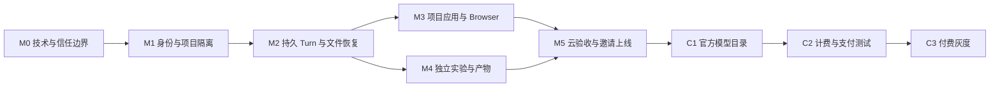

# Riffology Cloud 开发与部署完整计划

日期：2026-09-05  
状态：执行中；2026-09-06 G0 十项技术门禁及共同候选已通过，进入 M1 准备，尚未部署产品。最新证据见[开发执行状态](development-status.md)。  
范围：独立新产品的基础 MVP，以及后续首个付费版本

关联：[系统设计](mvp-system-design.md)、[平台与项目职责边界](platform-project-boundary.md)、[开发推演与风险登记](development-tabletop.md)、[模型库与付费设计](model-library-tenancy-billing-design.md)、[UI 设计](ui-design.md)。

## 1. 执行结论

先证明可信运行时、项目执行环境与持久化边界成立，再建设多租户建模闭环；基础 MVP 通过真实使用与故障验收后，才开放在线付费。

最先需要完成的工作是 M0 技术验证。当前按[ADR 0001](adr/0001-pi-project-trust-boundary.md)分离可信 Pi 宿主与项目执行域；分离拓扑本身不等于隔离验收通过。必须证明项目代码无法取得平台控制权限，再进入 M1。

本计划不承担其他系统的接口、数据、部署或功能兼容义务。后文的版本兼容、数据库演进和回滚，仅用于本产品上线后的正常发布。

### 1.1 已有产物与未实现工作

以下表格与本地记录保留计划建立时的基线；当前 M0 验收以[主控签收](evidence/runs/m0-g0-accepted-20260906/progress.json)为准，M1 工作包见[执行清单](m1-execution-plan.md)。

| 类别 | 当前证据 | 计划中的处理 |
|---|---|---|
| 产品与架构 | 系统、模型库、租户、计费设计已存在 | 按职责文档补齐信任边界；以阶段验收确定实现 |
| UI | `ui/` 本地原型，12 条路由；Chrome 三档视口与关键交互记录 | 复用视觉与流程；生产状态改由服务端提供，演示数据仅留测试环境 |
| 模型与 Agent | 机场画面、消息、文件和实验为示例；尚无真实 Pi / SimPy 链路 | Starter 成为独立项目包，Pi 通过受控工具修改它 |
| 后端与部署 | 已增加 M0 受控 Pi、保存/文件恢复、Sandbox、Preview、中断恢复及本地发布策略探针；T02 本地 10 case、T07 本地 Chrome 14 case 已有实际证据；staging 私有 R2 checkpoint bucket 已创建，Storage Worker 正准备首次部署但结果尚未确认 | 认证、Workers Paid/Containers 与 R2 基础资源前置已具备；仍需 required secrets、模型代理/预算、域名/TLS 和实际部署/验证矩阵，不把 preflight 或本地探针当成服务验收 |
| 本轮推演 | 文档检查、源码阅读、官方资料核查及故障路径推演 | 风险条目是预测与待验证事项，不能标成已复现的云故障 |

当前脚本包括 UI、完整检查、preflight、证据记录、Storage / Boundary / Files / Recovery 四套本地服务及独立 Preview 集成；见[运行手册](m0-local-runbook.md)。本轮最终本地检查为 [94 pass、1 个 opt-in Python 协议集成 skip、2 个自检](evidence/runs/m0-local-20260905084126655/local-checks.json)。[T02 边界证据](evidence/runs/m0-boundary-20260905083026073/boundary-local.json)和[T07 浏览器证据](evidence/runs/preview-browser-1788597480759/artifacts/preview-browser.json)只支持本地范围；[五套 dry-run](evidence/runs/m0-validation-20260905084126533/builds.json)及[本地候选复验](evidence/runs/m0-validation-20260905084126533/verification.json)已经完成，`canPromote=false`。[本地发布清单](m0-release-manifest.md)用于复验源码与产物，[发布策略探针](../spikes/m0-release/README.md)验证本地子进程准入与回退；两者都不能推广或关闭云门禁。后文的完整生产目录、CI 作业和发布流水线仍为待交付内容。

### 1.2 产品阶段

- **基础 MVP，M0–M5：** 邀请制个人 Tenant、独立项目、Pi Session、长期文件恢复、Browser 插件、固定机场 Starter、真实实验与运行额度；记录真实 AI 用量，在线支付关闭。
- **首个付费版本，C1–C3：** 官方目录与版本流程、Tenant 余额、请求级预留与结算、支付通知、退款或补偿、账务运营。
- **本计划不开放：** 团队协作、教学权限、订阅、公开分享、任意插件安装、多 Agent、多供应商选择、BYOK、完整 IDE、Git 同步和第二种仿真框架。

## 2. 开发组织、依赖与交付方式

建议角色：平台负责人 B1（身份、Actor、持久化），运行时负责人 B2（Pi、隔离、进程、模型契约），前端负责人 F（两端 UI、事件与错误体验），验证与运维 Q/O（可由其他角色兼任），产品负责人 P（范围、资源与收费政策）。角色代表责任，不表示已分配真实人员。

技术基线为 TypeScript 控制面和 Web 客户端、Node Pi 宿主、Python + SimPy 项目应用。具体 SDK、构建工具与依赖版本在 M0 锁定。UI 原型保留为设计参考；不要求复用其浏览器计数器或本地账本实现。



F 可在 M0 后依据已冻结的 API 与事件样例并行开发；B1/B2 可在 M2 契约稳定后并行推进 M3/M4。并行不跳过前置证据门槛。每个 PR 交付一个可验收的纵向流程，包括错误处理、必要测试和证据。

本次执行由主控 Agent 负责阶段顺序、架构决策、集成复审、故障验证和验收结论；复杂运行时工作拆为独立 subagent 子任务，证据脚手架、环境检查和运行说明交给低成本 subagent。每个子任务限定文件所有权；主控复核实际 diff 和测试后接入。subagent 的完成报告不直接关闭门禁。

### 2.1 拟定代码组织

```text
apps/web/                 生产 Web Shell、用户页与管理页
services/gateway/         登录、ACL、API/WS、Service/Artifact Gateway
services/coordinator/     WorkspaceAgent、TenantQuota、后续 TenantBilling
services/runtime/         可信 Pi 宿主、受控工具与进程协调接口
packages/contracts/       API、事件、错误、manifest 与结果 schema
packages/browser-plugin/  平台 Browser 插件及观察协议
packages/simulation-kit/  固定 Skill、simctl 适配与校验器
starters/airport/         独立模型、交互应用、实验计划及测试
infra/                    环境配置、镜像、迁移、发布与恢复脚本
tests/                    合约、集成、隔离、故障及浏览器验证
docs/evidence/            后续实际运行证据索引，不存秘密
ui/                       当前设计原型
```

这是责任分区，不意味着每个目录都必须部署成独立服务。Gateway 与 Model Proxy 可同部署；可信 Pi 与项目代码按 ADR 0001 分离执行域，具体云部署须通过 G0。Workflows 不是首版必需组件，持久派发采用 WorkspaceAgent 队列、alarm 和运行监管。

### 2.2 首先冻结的契约

| 契约 | 最低要求 | 权威方 |
|---|---|---|
| 身份与对象链 | User → Membership → Tenant → Project → Workspace；创建后归属不可由客户端切换 | Gateway / D1 |
| 外部写请求 | 幂等键包含主体、操作、目标及 payload 摘要；同键异内容冲突 | 对应协调者 |
| 控制命令 | command_id、workspace、generation、目标、deadline、允许操作与认证；响应去重 | WorkspaceAgent / 可信工具桥 |
| 事件 | schema_version、event_id、sequence、对象 ID、发生时间；游标过期返回快照和新游标 | WorkspaceAgent |
| 保存 | 不可变内容与 Session 包、摘要、父版本、提交指针；单次提交事件是“已保存”依据 | WorkspaceAgent + R2 |
| 项目声明 | `.riffology/` 只声明入口、参数和资源需求，不能注册平台代码或改变授权 | 项目提供声明，平台校验 |
| 运行计划 | 固定输入 Revision、依赖锁、参数组合、种子清单、样本 ID 与预算 | 项目定义内容，平台批准执行 |
| 项目状态 | 项目应用持有 simulation_state_id / sequence；平台封装 Preview ID、版本与观察时间 | 项目服务 + Browser 插件 |
| 租户运行额度 | 跨 Workspace 原子申请、释放与失联对账，不依赖页面计数 | TenantQuota 协调器，拟采用 DO |
| 计费，C2 | 请求 ID、Reservation、价目版本、互斥 Token 类别、追加账本、对账状态 | TenantBilling / Model Proxy |

TenantQuota 在 M1 起保障邀请制资源上限；TenantBilling 在 C2 负责金额。两者分别拥有一类权威计数，不由多个 Workspace 写同一余额或全租户并发数。

平台接收项目声明、进度与产物时仍执行 schema、路径、大小、摘要及归属校验。项目输出不能直接成为“已保存”“已结算”或管理员操作的权威收据。

### 2.3 每个开发工作包的交接规则

主控先确定所属层、前置契约、允许修改的文件、验收场景和禁止跨越的阶段，再派发独立任务。涉及同一状态机、账本或保存协议的修改由一个负责人整合；共享目录不是并行修改同一权威状态的许可。

实现者交付具体 diff、契约变更、验证命令及结果、尚未验证的环境和残余风险。主控检查代码与证据是否对应同一版本，执行必要的集成验证；代码变更后，旧证据只能支持未受影响部分。通过后才合入发布候选。环境不足时将工作包记为“本地完成 / 云验证待执行”，不得记作门禁通过。

从需求拆分到正式运行的工程推演见[推演文档 §3.0](development-tabletop.md#30-先模拟工程团队怎样完成开发与交付)。

## 3. 官方资料核验与 M0 决策

以下事实于 2026-09-05 核查；版本选择和工程措施是本项目方案，不是云平台自动提供的保证。实际开工时针对锁定的 SDK、镜像与账号复核，不混用 stable 和 preview 的代码示例。

| 核验结果 | 对本计划的约束 |
|---|---|
| Pi 默认 ResourceLoader 会发现项目扩展、Skill、上下文和用户配置。 | 实现受控 ResourceLoader、显式工具与模型白名单；恢复 Session 后重新验证，项目 `.pi/` 不能注入平台扩展。[Pi SDK](https://github.com/earendil-works/pi/blob/main/packages/coding-agent/docs/sdk.md) |
| Sandbox 的隔离边界是 VM；同一 sandbox 共享文件、进程与 localhost。 | 单独验证 VM 内可信 Pi / 控制通道与项目 Shell 的边界。[安全模型](https://developers.cloudflare.com/sandbox/concepts/security/) |
| 官方源码核查版本中，execution session 的 isolation 标志被忽略，bash spawn 继承环境，控制服务暴露 HTTP/RPC 入口。 | 这是源码风险线索，不是已完成云端攻击验证。禁止据 cwd、execution session 或 localhost 推断隔离。[session 源码](https://github.com/cloudflare/sandbox-sdk/blob/20f9da4a9eb297db64375c0a98753626e91b52ac/packages/sandbox-container/src/session.ts#L141-L159)、[spawn 源码](https://github.com/cloudflare/sandbox-sdk/blob/20f9da4a9eb297db64375c0a98753626e91b52ac/packages/sandbox-container/src/session.ts#L272-L286)、[控制服务源码](https://github.com/cloudflare/sandbox-sdk/blob/20f9da4a9eb297db64375c0a98753626e91b52ac/packages/sandbox-container/src/server.ts#L144-L186) |
| 容器磁盘随停止丢失；目录备份有 TTL，本地与生产恢复机制不同。 | 使用产品持有的长期 R2 清单与内容包；云端验证恢复后的删除、重命名与权限，不以本地恢复代替。[生命周期](https://developers.cloudflare.com/sandbox/concepts/sandboxes/)、[备份恢复](https://developers.cloudflare.com/sandbox/guides/backup-restore/) |
| 原始 Preview URL 默认是持有者可访问的能力；出站策略和 Worker 内凭据注入需要配置。 | 逐请求鉴权并阻断源服务绕行；密钥留在 Worker，拒绝任意目的地址及项目自报计费。[Preview](https://developers.cloudflare.com/sandbox/guides/expose-services/)、[出站控制](https://developers.cloudflare.com/sandbox/guides/outbound-traffic/) |
| Sandbox 包、基础镜像及 Python 运行环境需配套选择。 | 记录 SDK、镜像 digest、Pi、Python、SimPy、依赖锁与构建来源。[镜像配置](https://developers.cloudflare.com/sandbox/configuration/dockerfile/)、[部署指南](https://developers.cloudflare.com/sandbox/guides/deploy/) |
| DO 代码与调用方可能经历版本混用；类生命周期操作有独立发布限制，exports 与 migrations 不同时使用。 | 配置由锁定 Wrangler schema 校验；不将类生命周期变更与普通灰度混发。[DO 渐进部署](https://developers.cloudflare.com/workers/versions-and-deployments/gradual-deployments/with-durable-objects/)、[类生命周期](https://developers.cloudflare.com/durable-objects/reference/durable-objects-migrations/) |
| Containers 发布中 Worker 激活先于后续镜像 rollout；成功启动 rollout 不代表所有实例已更新。 | 分别验证 Worker、镜像、实例和业务闭环；新旧协议须可共存。[Containers rollout](https://developers.cloudflare.com/containers/configuration/rollouts/) |
| Worker 回滚不恢复绑定存储；D1 Time Travel 不同时恢复 DO、R2 或外部支付。 | 代码回退与数据恢复分开；账务不能通过单独回滚 D1 修复。[Worker 回滚](https://developers.cloudflare.com/workers/versions-and-deployments/rollbacks/)、[D1 Time Travel](https://developers.cloudflare.com/d1/reference/time-travel/) |

若后续引入 Workflows，其重试仍要求应用处理外部副作用幂等，不能保证 Pi 进程、Shell 或 LLM 调用 exactly once；这一点不改变首版架构。[Workflows 规则](https://developers.cloudflare.com/workflows/build/rules-of-workflows/)

### 3.1 G0 云端技术验证

在新建的专用测试资源中运行，使用合成项目与受限模型预算。所有结果须携带版本锁、账号环境、命令、退出码、摘要及可重复步骤。当前云端签收与未完成项以[最新开发状态](development-status.md)为准；以下表格定义验收要求，不表示所有项目仍未执行。

| 编号 | 验证内容 | 通过证据 / 失败处理 |
|---|---|---|
| G0-T01 | 锁定 Pi SDK 的最小真实调用、流式事件、取消、Session 保存恢复 | 捕获供应商请求 ID、事件与恢复后上下文；SDK 缺口先实现最小适配验证 |
| G0-T02 | 从项目 Shell 尝试读取可信文件、进程环境、Session 恢复包，发信号、访问控制 HTTP/RPC 与 IPC | 敏感数据和越权控制均被拒绝；仅 chmod 或不同 cwd 不足以通过 |
| G0-T03 | 放入 `.pi/extensions`、项目 settings / models、伪造 Skill 后启动及恢复 Pi | 没有加载未授权代码、模型或工具；否则阻断 |
| G0-T04 | 两个 Workspace 同时读写；互换对象 ID、服务 URL、Artifact ID、过期令牌 | 所有跨归属请求被拒绝；记录入口与拒绝原因 |
| G0-T05 | 云上执行连续 20 次新增、修改、删除、重命名，提交后销毁重建 | 文件清单、内容摘要、权限与删除项一致；恢复后仍可写及重命名 |
| G0-T06 | R2 上传中断、提交前崩溃、提交后事件未送达 | 只恢复完整提交，重连补发一次已保存事件；孤立对象可回收 |
| G0-T07 | 原始 Preview、子资源、WS、撤权、重定向与 Cookie / Origin 边界 | 不绕过平台权限、不携带主应用登录凭据；缺一个入口即阻断 Browser 开放 |
| G0-T08 | 断浏览器、杀 Pi、杀容器、恢复后发送旧 generation 事件 | 浏览器断开任务继续；进程故障有 interrupted 终态；旧实例写入被拒绝 |
| G0-T09 | 关闭任意互联网，允许模型代理和限定依赖源；尝试改目的地址、读取密钥 | 出口策略实际生效；项目不得调用充值、改价或直接结算接口 |
| G0-T10 | 新 Worker 配旧镜像、新旧事件协议、镜像启动失败、退回上一版本 | 明确混合窗口行为；部署记录、实例版本与恢复闭环可核对 |

T07 在 M0 使用平台控制的、与生产隔离的 staging 测试身份验证全部 Preview 入口及凭据边界（包括子资源、WS、撤权、重定向和 Cookie / Origin）；不得以生产凭据或未验证的登录替身降低入口要求。M1 交付正式登录后，再用生产身份重验相同链路；两阶段相互衔接但不构成循环依赖。

G0 的目标是小规模证伪关键假设，不要求先实现完整产品。可用临时探针完成；G0-T04/G0-T06/G0-T08 先证明所需原语，M1–M5 再用生产链路完整验收。

**G0 架构决策：** ADR 0001 已选择分离执行域，工具通过受鉴权的远程边界操作项目文件和 Run。G0-T01–G0-T09 验证这一拓扑的调用、恢复与权限；G0-T10 另验发布和回退，十项均通过后才关闭 G0。仅移走 Pi 但仍向项目暴露可扩大权限的控制 API，也不能通过。后续若改变拓扑，须先更新 ADR 并重新取得受影响门禁证据，不能凭实现便利回到未验证的同域高权限执行。

## 4. 分阶段开发工作包

### 4.1 基础 MVP

| 阶段 | 开发与联调内容 | 交付与退出条件 | 主责 / 依赖 |
|---|---|---|---|
| M0 | 版本锁、信任边界探针、R2 长期快照验证、Preview 访问、成本与冷启动基线；冻结 contracts | G0 报告、架构 ADR、资源清单、最小真实调用与恢复证据 | B1/B2，Q/O 配合 |
| M1 | 登录与邀请、个人 Tenant/Membership、项目幂等创建、TenantQuota、WorkspaceAgent、隔离执行环境；项目页接真实 API | G1：两用户并行；对象篡改拒绝；同租户两个项目抢最后一个运行名额只有一个成功；创建中断可对账 | B1/F；依赖 G0 |
| M2 | 受控 Pi 宿主与工具、单写者、Turn 队列与持久 outbox、事件去重/回放、Revision/Session 包、取消和恢复 | G2：真实建模、20 次文件操作、浏览器断线、容器销毁、保存失败、未知副作用不重放；无幽灵 running | B2/B1/F；依赖 G1 |
| M3 | 固定机场项目包、项目应用后端、Browser Plugin Host、鉴权代理、Observer；把业务控件移出平台壳 | G3：用户与 Agent 观察同一项目状态；模型暂停/服务停止/关闭 Panel/禁用插件分别验证；第二个非机场最小应用无需修改 Shell 即可真实启动、观察、停止和展示结果 | B2/F；依赖 G2 与项目契约 |
| M4 | 通用 Run Executor、参数与种子计划、结果 schema、日志分段、取消、Artifact、有限批量实验 | G4：20 个样本每个有实际收据与唯一种子；部分失败/停止计数准确；输入版本不被后续编辑改变；CSV 可核对 | B2/B1/F；依赖 G2 |
| M5 | 配额硬限制、休眠、GC、恢复工具、管理端实际状态、审计、负载与故障验收、生产配置和运行手册 | G5：§5 全部硬门槛通过；§7 staging 演练通过；内部租户后进入邀请制灰度，付费关闭 | Q/O 组织，全员；依赖 G3/G4 |

M2 内部先实现“文件与保存点 → durable Turn → 真实 Pi → 断线恢复”，避免把不可恢复的 Agent loop 接到已经上线的 UI 后再补持久化。M3 先验证普通受控项目服务，再添加机场交互和观察；M4 先单次 Run，再扩为批量。

M1 选择一个受维护的登录方案并完成服务端会话验证、邀请准入、撤权、CSRF/Origin 与 WS 鉴权；不把原型的演示邀请码逻辑发布到生产。平台管理身份与普通项目所有者分别授权。

本计划的管理端仅开放运维元数据、配额、任务控制和账务记录，管理员身份不能读取用户文件、对话、Preview 或业务结果。M1 验证这些内容入口对运维身份拒绝，M5 再验证日志和诊断没有旁路泄露。将来若加入内容协助，须另行实现由用户授予的项目范围、期限、撤销与审计；当前不预留一个不受约束的“管理员进入项目”后门。

### 4.2 首个付费版本

| 阶段 | 工作包 | 退出条件 |
|---|---|---|
| C1 | 官方 ModelVersion、不可变包、许可与假设、工程验证、发布/撤回、固定版本复制；管理端接真实接口 | GC1：两个项目与官方资产互不改写；发布新版本不改旧项目；撤回仅阻止新增；包解压与依赖安装受控 |
| C2 | TenantBilling、PriceBookVersion、真实请求级 usage、Reservation、消费/补偿、PaymentOrder、签名通知、主动查询及投影 | GC2：支付渠道测试模式；并发不透支，重复通知不重复入账，未知 usage 不重放、不当零费用；核对与补偿链路完整 |
| C3 | 正式价格与条款配置、运营对账、故障演练、小额付费灰度、订单与退款入口 | GC3：产品政策已确定；小额真实支付/消费/退款闭环有凭据；确认观察期无硬门槛事故后扩大 |

C2 先用模拟供应商测试精确计量和副作用，再用真实供应商的小预算请求核验 usage 语义，最后使用支付渠道测试环境。浏览器成功跳转不承担入账逻辑。

同租户多项目、同请求并发重试、迟到响应、取消与结算竞争、缓存/推理 Token 子集以及小额舍入必须有确定性测试。生产金额采用整数最小单位或固定精度计算；本地 UI 示例价目 `demo-2026-09` 不自动成为正式售价。

各阶段重点关闭的[风险登记项](development-tabletop.md)：G0 对应 R04/R05/R08/R09/R13 的可行性；G1 对应 R02/R03；G2 对应 R04–R08/R12/R13；G3 对应 R01/R09/R10 及 Starter 的 R16；G4 对应 R11/R12；G5 复验前述硬边界并关闭 R17。GC1 对应 R03/R16，GC2 对应 R07/R14/R15/R18，GC3 复验资金风险和真实成本。风险关闭必须有对应证据，开发完成状态不能直接关闭风险。

### 4.3 工期估算与关键路径

以下为规划估算，不是交付日期承诺。假设 3 名全职工程角色，加约 0.5 名验证/运维投入，账号资源已可用，只有一个 Starter 和主供应商。

| 工作包 | 预计工程人日 |
|---|---:|
| M0 | 8–12 |
| M1 | 10–14 |
| M2 | 16–24 |
| M3 | 8–12 |
| M4 | 8–12 |
| M5 | 10–16 |
| 基础 MVP 合计 | 60–90，另留约 25% 集成与未知项缓冲 |
| C1 / C2 / C3 合计 | 24–40，另计支付渠道准入及业务决策等待 |

按依赖和验证窗口，基础 MVP 可先按 8–12 个自然周排期；付费扩展再预留 4–6 周。M0 后用真实探针结果重估。内部隔离不成立、账号不支持所需能力、支付准入延迟，都会改变关键路径；不通过缩短隔离/恢复测试抵消。

### 4.4 用户端与管理端的开发验收映射

路由以现有设计名定位，生产实现可调整 URL。表中全部页面属于平台产品，只有工作台 Browser 内的领域页面属于项目资产。各项仍受前置门禁约束；页面可提前用明确标记的 fixture 开发，验收须连接对应真实服务。

| 端 / 页面 | 服务与权威状态 | 首次接入 / 主责 | 必须验证的结果 |
|---|---|---|---|
| 用户：邀请登录 | 身份服务、邀请与会话 | M1 / B1 + F | 有效邀请登录；无效、过期与撤权后拒绝；刷新保持合法会话 |
| 用户：我的项目 | Project Catalog、初始化状态、来源记录 | M1–M2 / B1 + F | 幂等创建和固定 Starter 初始化；甲乙隔离；半成品不显示就绪 |
| 用户：工作台 | Turn / Revision / Run / Browser 的独立状态 | M2–M4 / B1 + B2 + F | 修改、保存、重连、取消、预览与真实实验；保存或观察失败不伪装为成功 |
| 用户：模型库 | 不可变 ModelVersion 与复制服务 | C1 / B1 + B2 + F | 固定版本复制不触发 LLM；修改副本不影响官方或其他项目；撤回拒绝新复制 |
| 用户：用量与余额 | MVP 用量与配额；C2 账本与预留 | M5、C2–C3 / B1 + F | 真用量与未知状态可区分；测试充值不进生产；重复通知不重复入账 |
| 用户：设置 | 个人信息、项目插件绑定、预算策略 | M1、M3、C2 / B1 + F | 只能修改授权对象；禁用插件撤销旧能力；预算由服务端执行 |
| 管理：概览 | 经授权的运维投影 | M5 / B1 + F + O | 指标可回查权威对象；陈旧投影有时间与状态提示；无项目内容泄露 |
| 管理：官方模型 | 发布验证、许可、版本和审计 | M3 固定包资料、C1 完整流程 / B2 + F | 验证绑定包摘要；更新只创建新版本；私密夹具被拒绝 |
| 管理：租户与额度 | Membership 元数据、TenantQuota | M1、M5 / B1 + F | 配额修改留原因与审计；同 Tenant 两项目争抢名额不超发；无内容入口 |
| 管理：运行与故障 | 指定 Turn / Run、租约及脱敏诊断 | M2、M4–M5 / B1 + B2 + F | 停止正确对象并确认退出；未知结果有处置入口；不提供盲目全量重跑 |
| 管理：账务与对账 | TenantBilling、订单、追加调整 | C2–C3 / B1 + F + O | 金额守恒、重复回调幂等、未知消费限时处置；禁止直接覆盖余额 |
| 管理：审计 | 平台生成的追加操作记录 | M1 起写入、M5 UI / B1 + F + O | 可追溯主体、对象、原因和结果；无编辑删除入口；查询与导出有授权 |

### 4.5 阶段结束时必须交接的内容

每个阶段交付：可运行代码与锁文件、已冻结契约、用户端和管理端的真实流程、自动化与故障证据、风险处置记录、部署和恢复说明。若某一端的功能在后续阶段才开放，当前版本以服务端开关关闭，而非留下能修改示例数据的入口。M5 和 C3 另附候选版本清单、环境核对结果、观察期记录和正式值守安排。

## 5. 测试、证据与阻断规则

### 5.1 测试层次

| 层次 | 必须证明的事情 | 运行位置 |
|---|---|---|
| 单元与属性测试 | 状态转换、金额舍入、互斥 Token 分类、幂等键、参数/种子计划、配额不超发 | 每 PR |
| 合约测试 | Web/Worker/DO/runtime/Python schema、旧新事件兼容、未知字段与版本拒绝策略 | 每 PR、发布候选 |
| 本地集成 | 数据索引、控制接口、工具路径与恢复包；用可控 provider 模拟超时/缺 usage | 每 PR 或合并主干 |
| 云集成 | 实际网络/VM、R2 恢复、Preview 代理、出站、DO 重启及 rollout | staging；本地不能替代 |
| 浏览器 E2E | 登录→创建→Pi 修改→已保存→Preview→实验→刷新恢复；管理端对应操作 | staging 三档视口 |
| 故障与并发 | 重复派发、R2 失败、runtime 杀死、旧 epoch、撤权、并发名额和余额 | 隔离的测试 Tenant |
| 模型验证 | 同一模型入口的 Preview/单次/批量一致；资源守恒、种子复跑、统计计数 | Starter 项目包测试 |

用假供应商验证的流程标为 deterministic/mock；用真实供应商的结果附 provider request ID。测试记录区分 UI、runtime、LLM、仿真、持久化与支付，不能相互替代。

### 5.2 上线硬门槛

1. 已知跨租户越权、平台控制权限泄露、凭据泄露为零；服务端权限测试矩阵全通过。
2. 已确认保存的版本在重建后完整恢复；当前版本与被运行引用的对象不被 GC。
3. 重复请求、事件、回调不重复执行已确认副作用；未知状态有对账终态，不盲目重跑。
4. 两个 Workspace 不能突破同 Tenant 的运行额度；付费版本不能突破已授权余额与回合预算。
5. 用户可区分模型暂停、Preview 服务停止、Turn 取消、Run 停止及 Panel 关闭；确认停止后无目标子进程遗留。
6. 真实实验计数等于已校验并保存的样本数；项目业务输出不冒充平台保存或计费收据。
7. 存量引用、审计和必要账务记录的保留规则明确，删除项目不连带删除余额或支付凭据。
8. 发布和恢复演练成功；代码回退后重新完成真实建模与保存链路。

上述项目出现一个失败就阻断相应阶段发布，不能用平均成功率或 UI 截图抵消。核心体验另沿用系统设计：预先保存 20 个任务与条件，真实闭环至少成功 16 个；其余任务必须有准确失败说明。

三组“20”分别验收：G0-T05 / G2 的 **20 次文件操作**检查文件能力；G4 的 **20 个实验样本**检查逐样本真实结果和完整计数；G5 的 **20 个预先定义用户任务**评估整体体验。它们不能互相代替，16/20 的体验目标也不降低权限、保存、资金等硬门槛。

### 5.3 证据包

每个门槛输出 `gate-result`：测试环境与版本、用例 ID、输入/种子、Tenant/Workspace/Turn/Run/Revision 的测试标识、预期、实际、时间、结果、日志/截图/摘要链接、缺陷及重测关联。

发布候选关联 Git SHA、前端资源摘要、Worker version、DO schema 版本、runtime 镜像 digest、Pi/Skill/Starter 版本、R2 Checkpoint 格式、迁移批次和测试报告。测试凭据使用合成账户，敏感值不进入报告。

## 6. 环境、资源与 CI/CD

### 6.1 环境隔离

| 环境 | 用途 | 资源与限制 |
|---|---|---|
| local | 单元、mock、UI 与快速集成 | 本地数据；无生产凭据；当前 4173 原型只用于设计 |
| staging | 真实云能力、故障注入、支付测试、发布恢复演练 | 独立 D1、R2、DO namespace、执行环境、域名和 Secret；合成数据与受限 provider 预算 |
| production | 邀请用户，GC3 后开放付费 | 独立资源与最小权限部署令牌；生产开关、数据保留与值守落实 |

能分账号则分账号；至少严格分资源、凭据和访问策略。环境名不能只存在于前端变量。CI 检查 bindings 的实际资源 ID，拒绝 staging 作业指向生产资源。

M0 在资源台账确定：Cloudflare 账号/地区约束、Sandbox 可用性与容量、D1/R2/DO 标识、主应用域名、独立 Preview 域名、证书与 DNS、主供应商、登录方案和预算上限。本文不虚构资源 ID、真实域名或 Secret 值。

供应商、登录与支付凭据保存在受控 Secret 系统，部署引用 Secret 名称。项目目录、恢复包、Docker layer、日志和前端构建均不包含这些值。明确轮换、撤销和过期行为。

### 6.2 CI 作业规划

| 作业 | 触发 | 内容与输出 |
|---|---|---|
| validate | 每 PR | 格式/类型、契约、必要单元测试、依赖锁、禁止生产 mock、Secret/产物检查 |
| integration | 改动相关组件 | 控制面与 runtime 集成、Starter 检查、恢复包与金额边界 |
| build-release | 合并或候选标签 | 一次构建并锁定不可变镜像/前端包；输出 release manifest，禁止生产用浮动 latest |
| deploy-staging | 候选 manifest | 核对资源→兼容迁移→部署→等待实例状态→云 E2E/故障回归 |
| promote-production | 已验收候选 | 推广同一已测试产物；验证生产配置与责任人放行记录 |
| verify-release | 每次部署后 | 校验公网、登录、对象权限、runtime 版本、真实小预算闭环、观测与对账 |

镜像执行用户、写权限、入口及依赖在构建测试中验证。npm/Python 依赖、容器镜像与 Skill 来源可追溯；依赖安装是代码执行，不能只靠软件包名称白名单而忽略安装脚本、外连和持久化污染。

## 7. 完整部署流程

### 7.1 首次 staging / production 部署

| 顺序 | 操作 | 可核对的完成条件 |
|---|---|---|
| D01 | 选定已通过门槛的 release manifest，核对账号、环境、预算与开关 | 产物摘要与环境资源台账一致；支付仍关闭 |
| D02 | 创建环境专属存储、DO 绑定、域名、Secret 和部署权限 | staging/prod 资源无混用；独立 Preview 源可用 |
| D03 | 创建/扩展 D1 与 DO schema；DO 类生命周期操作单独处理 | 迁移日志、schema 版本、空库初始化和重试均可核对 |
| D04 | 校验 release manifest 指定的已构建镜像及 Python/SimPy/Pi/Skill，不在推广时重新构建 | 镜像摘要与已测试候选一致、可启动，组件版本和信任边界探针通过 |
| D05 | 部署协调层、Gateway/Model Proxy、runtime 绑定与策略 | 不只看 CLI 成功；分别确认 Worker 激活、镜像 rollout、目标实例健康 |
| D06 | 导入固定 Starter 的不可变版本和初始管理身份 | 摘要、来源、许可、检查结果有效；无用户数据混入 |
| D07 | 发布匹配的 Web 客户端，关闭角色切换、演示充值及场景切换入口 | UI 状态来自真实 API；服务端权限不依赖隐藏菜单 |
| D08 | 从公网验证 TLS、登录/撤权、CSRF/Origin、WS、文件/Artifact 与 Preview 子资源 | 无源端绕行，权限拒绝矩阵和实际访问路径都有证据 |
| D09 | 用两名测试用户执行建模→保存→Preview→实验→重建恢复 | 真实请求、进程、文件摘要与运行结果可追溯 |
| D10 | 确认告警、备份、GC、用量、配额、停止和回退工具 | 进行一次受控故障及恢复演练；值守人能按手册完成 |
| D11 | 先开放内部 Tenant，再开放邀请白名单 | 观察期无硬门槛事故；扩容前记录成本与性能 |

首次 production 只推广已在 staging 验证的同一构建；环境绑定、Secret 与 DNS 分别核对。D03 的数据迁移不能因重试部署而重复破坏数据。

### 7.2 后续版本、混合版本与活跃任务

普通数据演进采用 **新增兼容字段/表 → 兼容代码 → 回填与验证 → 停止旧读写 → 后续版本清理**。这不等于 DO 类创建、重命名、转移或删除；类生命周期操作另行验证其发布限制。

Gateway、WorkspaceAgent、runtime 与客户端协议显式带版本。兼容窗口至少覆盖当前版本及上一已发布版本；不支持的协议拒绝新任务并给出恢复入口，不能把无法解析事件丢弃后显示成功。

基准发布策略是按 Tenant 固定灰度名单，不随机把同一 Workspace 的控制请求分给不兼容协议。涉及镜像时，先在新建测试 Workspace 验证，再推广。

对活跃 Workspace，按实现成熟度选择以下路径，并在 staging 演练通过后使用：

- 平台已实现独立 runtime 版本池/路由时，当前任务保持原 release；新任务进入新池，旧池保存、排空后退役。
- 版本池尚未实现时，安排维护窗口，关闭新增 Turn/Run，等待有限任务结束或按已声明规则中断并保存，核对无活动写者后更新镜像。允许短暂停服，不宣称无缝热升级。

不得仅通过配置容器 grace period 就声称活跃会话已固定版本。Worker 流量灰度与容器镜像 rollout 分别跟踪。生产 rollout 启动后持续核对目标版本和实际实例，不以命令退出成功结束发布记录。

### 7.3 上线开关与观察期

服务端开关至少包括：`admission_new_work`、`browser_enabled`、`catalog_publish_enabled`、`billing_mode=off|test|live`、`payment_new_orders`。关停新增工作仍允许必要的查询、保存、结算、回调接收和已有订单对账。

建议邀请阶段依次采用“内部测试租户 → 小批邀请名单 → 扩大邀请”，每阶段至少覆盖一个工作日的运行、休眠与恢复，并达到预定任务样本量。付费从测试模式转为少量 Tenant 的小额真实闭环，经过退款和对账验证后再扩大。

观察时长只是下限；请求不足或出现疑点就延长，不能因时间到期自动放量。任何越权、已保存数据丢失、重复收费或不可解释的余额差异立即停止放量。

## 8. 回退、恢复与删除

### 8.1 故障处置顺序

1. O 关闭新增工作的准入；资金异常同时关闭新支付订单与新付费调用，保留有效支付回调和对账入口。
2. 保留故障 release、事件、请求 ID、Checkpoint 引用、账务预留与实例信息，控制日志中的内容暴露。
3. B1/B2 判断是 UI/代码、镜像、schema、项目内容还是账务数据问题，选择对应恢复路径。
4. 完成小范围修复或回退，先用测试 Tenant 验证，再恢复原用户的读取/工作入口。
5. Q/O 核对保存、任务与账务，无未解释差异后才重新开放新增工作。

### 8.2 分组件恢复

| 故障 | 应对措施 | 禁止的捷径 |
|---|---|---|
| 前端 / 无破坏性 Worker 代码缺陷 | 退回已知可用构建，校验仍能读取当前 schema | 把前端恢复当成 runtime 与数据恢复 |
| runtime 镜像启动失败或协议不兼容 | 停止准入；退回旧镜像目标/版本池，等待实例就绪；从 Checkpoint 恢复并对账 | 只回退 Worker 而继续路由到坏镜像 |
| DO 类生命周期或不可逆 schema 变更 | 使用事先演练的前向修复/恢复方案；核对 namespace 与数据引用 | 删除 namespace 或假设平台能跨生命周期变更一键回滚 |
| Workspace 热数据损坏 | 恢复最后完整提交，递增 generation；活动任务置 interrupted 后对账 | 自动重放结果未知的工具或 LLM 请求 |
| D1 目录 / 索引损坏 | 保留备份后受控恢复；按权威 DO 重建投影，核对身份 ACL | 恢复旧 ACL 后立即开放所有入口 |
| 账务错误 | 冻结新增收费，依据支付/Provider 证据与 TenantBilling 追加纠正和补偿 | 删除原消费，或单独回滚 D1/DO 后忽略外部已成功支付 |

恢复手册应覆盖同一时间切点的元数据清单、DO 状态备份/恢复记录、R2 对象引用与支付事件处理水位。分别恢复多个存储后，先在隔离范围核对引用和幂等记录，再开放写入。

### 8.3 备份、GC 与数据保留

当前和被 Run/Artifact 引用的 Checkpoint 不过期；保留策略针对产品版本包，而非临时备份句柄。R2 清理采用标记、宽限期、再次核对引用后删除，记录回收清单；正在提交的对象不能被并发 GC。

项目删除先置 `deleting`、撤销访问及新增工作，再停止对应任务、释放运行额度、按保留政策清理文件与产物。已确认消费、必要支付审计和其他项目数据不受影响。删除及撤回的幂等记录必须能阻止迟到回调重新创建对象。

上线前确定备份频率、数据保留期及灾难恢复 RPO/RTO；通过隔离环境的真实恢复演练验证。正常 runtime 重建要求已提交版本不丢失；这与整账号或存储灾难下的恢复目标分别记录。

## 9. 观测、成本与上线运营

| 指标 | 发现的问题 | 响应 |
|---|---|---|
| 被拒绝的对象归属、异常 Preview/控制入口访问 | 越权或代理绕行 | 安全事件即时告警；必要时关闭对应能力 |
| checkpoint 失败、最老未保存任务、恢复摘要不一致 | 数据可靠性下降 | 暂停休眠/写任务，保留热文件并修复保存 |
| queued/running 年龄、租约失联、取消后进程残留 | 派发、运行或恢复失效 | alarm 对账、停止目标进程、标记 interrupted |
| 事件积压、断线回放失败、D1 投影落后 | UI 状态陈旧 | 提供权威快照、重建投影，不反向覆盖 DO |
| 活动 VM、CPU/内存、执行时长、存储、Observer 占用 | 资源成本超预期 | 原子配额、最大时长、休眠、观察频率限制 |
| Provider 请求、usage 缺失、预留年龄、账务差额 | 错误收费或未知成本 | 停止新收费、进入人工对账；不猜测 usage |
| release 与实例版本、冷启动、真实闭环耗时 | 发布或容量问题 | 延迟放量，回退或调整容量 |

每条告警指定责任人、处理入口、响应时限与可用的降级方式。日志以对象 ID、阶段、错误类和摘要为主，默认不采集完整项目代码、对话或支付敏感内容。

M0 测量典型小项目的首次 Preview、热回合、Checkpoint、恢复与取消耗时；M5 固化分位数目标、压测规模和告警阈值。容量至少覆盖计划首批并发，再进行约 2 倍准入压力测试，验证超额请求排队或拒绝而非击穿额度。具体实例数与费用依据账号限制及测量填入资源台账，不在本文虚构。

费用分开记录：LLM 请求成本、计算/Observer、Workers/DO、D1/R2 与存储增长、支付渠道和故障补偿。发布前设置平台总预算与每 Tenant 上限；AI 余额不替代运行成本控制。免费邀请试用也有服务端调用与资源配额。

## 10. 开发开始与上线前决策清单

| 决策 | 最晚时间 | 责任与完成物 | 未确定时的动作 |
|---|---|---|---|
| Pi / Sandbox / Wrangler / Python 版本与可信执行拓扑 | M0 / G0 | B2/B1：版本锁、ADR、G0-T01–G0-T10 证据 | 阻断 M1 的真实执行接入 |
| 登录方式、Cloudflare 账号与区域约束、测试域名、Provider 测试预算 | M0 | P/O/B1：资源与访问台账 | 可继续契约和本地 mock，不作云验收宣称 |
| Preview 代理无绕行、内部控制通道隔离 | G0，G3 复验 | B1/B2：入口矩阵与拒绝证据 | Browser 或真实项目执行不得开放 |
| 资源配额、性能阈值、保留期、RPO/RTO 与值守 | G5 | P/O：运行政策、测量、告警和恢复演练 | 阻断邀请上线 |
| 官方发布责任、许可、工程检查要求 | GC1 | P/B2：版本发布材料 | 固定 Starter 可用，完整目录不发布 |
| 支付渠道、币种、价格、退款、余额有效期、对账 SLA | C2 开发前确定渠道，GC3 前全部冻结 | P/O/B1：产品配置与用户可见政策 | 保持 billing off/test，不开真实支付 |

正式交付的一组证据应让另一位工程师能够定位构建、复现部署、核对当前状态并执行恢复。所有部署步骤完成后，才能把发布状态从“已构建/已派发”改为“线上已验证”。

## 11. 当前执行入口与计划维护

1. 对照[开发执行状态](development-status.md)核对已有代码与证据，继续补齐未通过的 G0 项；已有版本锁和本地结果不重新计为待开工，也不直接计为云端通过。
2. 资源能力未就绪时，可继续契约、确定性测试、固定文件夹具、构建与文档；云门禁保持未通过。账号、预算或支付政策需要决策的事项记录 Owner 和依赖，不能通过本地替身消除阻断。
3. 冻结 contracts、项目 manifest 与实验结果 schema，用机场与一个最小第二应用检查通用性；按[固定边界提示](platform-project-boundary.md#11-写入设计与开发任务的固定提示)复核每个任务。
4. 按 §4.4 对接两端页面，先消除领域控件、模拟计数和平台状态的混用；进入真实用户流程前完成正向和拒绝路径验收。
5. 主控审查 G0 证据与 ADR 后，按实际结果更新估算并拆解 M1。后续每阶段同样执行“交付 → 独立复审 → 故障与恢复验证 → 门禁结论”。

本文件规定开发与部署顺序，桌面推演记录风险假设，执行状态记录已发生的工作。三者分别更新：推演不充当实测证据，局部测试不代表产品上线，计划中的发布步骤不代表已经部署。
