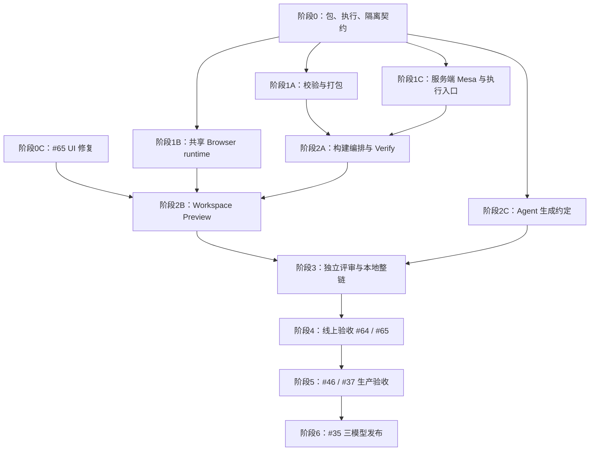

# Issues 多阶段 subagent 工作计划

日期：2026-09-15。状态：**G0–G3本地签收；G4本次受控执行完成、部分issue门槛仍未关闭**。G1保留本地翻译隔离与原生生产资源验收边界。进度见[实施记录](issues-development-log-20260915.md)，逐issue关闭条件见[签收矩阵](issues-acceptance-matrix-20260915.md)。

主线：**#64 浏览器 Preview 产品化 → #46 / #37 生产验收 → #35 官方模型**。#65 在契约准备阶段并行修复，在 #64 修改工作区入口前完成集成。

## 1. 当前基线与本轮范围

以下为开工基线，通过 GitHub 实时读取 issues / PR，并与本地代码核对；实施候选与当前状态见上方记录：

- 仓库：`jihegao/riffology-cloud`；默认分支 `main`。本地 HEAD 与远端 `main` 均为 `40aee17ed810430ee71fa4afb02af6fecf59b26a`。
- **5 个开放 issues，0 个开放 PR**；#28、#29、#30、#31、#32、#33、#34、#45 已关闭，不再按旧计划从头开发。
- [PR #62](https://github.com/jihegao/riffology-cloud/pull/62)已合并研究闭环验收记录；[PR #63](https://github.com/jihegao/riffology-cloud/pull/63)已合并 Mesa/Pyodide spike。前者的线上证据对应其记录的历史发布，后者未接入生产 Workspace。
- [旧执行计划](research-loop-execution-plan.md)和[旧交付记录](research-loop-delivery.md)保留为历史；当前优先级和待办以本文为准。历史线上签收见[研究闭环验收](user-preview-research-loop-acceptance-20260914.md)。本次未重新核验线上 Worker、门禁或云资源。
- 开工实际核对主工作树有五个既有 tracked 文档修改：`README.md`、`docs/development-status.md`、`docs/m3-service-run-contract.md`、`docs/research-loop-delivery.md`、`docs/research-loop-execution-plan.md`，以及本计划未跟踪文件。它们保持原位，不纳入实施分支提交。另有 detached worktree `../riffology-cloud-mesa-browser-runtime`，保持原位。

| Issue | 当前代码基础 | 本轮应安排的剩余工作 |
| --- | --- | --- |
| [#64 · P0 Browser Preview Generation Pipeline](https://github.com/jihegao/riffology-cloud/issues/64) | `spikes/mesa-browser-runtime/` 已验证 Mesa 和普通 Python Queue 共用协议/renderer | 新增生产包契约、校验/打包/存储、共享 runtime、自动生成、Workspace、服务端验证交接及真实验收。 |
| [#65 · P2 Workspace UI](https://github.com/jihegao/riffology-cloud/issues/65) | 已定位准备提示残留和重复导航 | 实现修复、兼容旧导航状态、三视口检查及部署后验收。 |
| [#46 · P1 生产模型通道](https://github.com/jihegao/riffology-cloud/issues/46) | ADR、provider adapter、金额预算与未知请求保留已合并 | 核实账号/默认模型/价格和数据策略，完成真实普通用户建模与有界 benchmark，验证完整调用链计费/恢复。 |
| [#37 · P1 按需启动与环境复用](https://github.com/jihegao/riffology-cloud/issues/37) | lazy Project、Workspace 租约、原生本地 10-Turn 已交付 | 云端冷/热/恢复对照、低容量公平性、取消/回退、真实释放验收；复核历史 `trusted-pi-release-deadline-exceeded` 事件。 |
| [#35 · P1 官方模型晋升](https://github.com/jihegao/riffology-cloud/issues/35) | readiness、冻结提交、审核/发布、独立复制已有实现 | Browser Preview 与发布/复制的必要兼容；前三个普通用户模型全流程验收。 |

计划编写时只交付计划及导航；2026-09-15 用户已授权按本计划实施多阶段开发和动态 subagent 并行。当前本地实施在独立集成分支推进，阶段4线上范围与阶段5真实账号/预算仍按各阶段门槛形成具体清单后确认。

## 2. 已发现的依赖，先解决再并行

### 2.1 Mesa 浏览器成功还需要服务端运行支持

[`services/simulation/source.ts`](../services/simulation/source.ts) 的 dependency lock 目前只允许空依赖或 `simpy=4.1.1`；[`Dockerfile.simulation`](../services/run/Dockerfile.simulation)也只安装 SimPy。#64 的 Schelling 验收包含 **Verify as Experiment**，必须增加经版本锁定的 Mesa 服务端执行 profile，并提供与现有研究运行输入/输出一致的入口。这个任务与 Browser runtime 同批开发，是完整 #64 的硬依赖。

### 2.2 旧 Preview 必须能准确指向冻结版本

[`services/workspace/durable.ts`](../services/workspace/durable.ts) 的现有 simulation / experiment 提交从当前 head 解析 source 并检查版本。计划增加有项目权限校验的冻结 Revision 解析：验证旧 package 时只运行对应保存版本；源已不可用时明确拒绝。不能收到旧 package 后静默改用最新 head，也不能信任客户端 R2 key。

Browser 和 server 同时冻结运行输入语义；将可调 `steps/horizon` 声明为 Model Spec 中的普通参数，沿用 `parameters + seed` 输入，避免增加尚未贯通的顶层字段。采用服务端已有 seed 范围，不让 spike 中较宽的 seed 输入在交接时发生截断或改值。Browser 的播放速度仅控制显示，不改变实验输入。

### 2.3 生成资产路径必须兼容已有发布链

[`services/publication/readiness.ts`](../services/publication/readiness.ts)当前只接受 `model/`、`app/`、`experiments/`、`docs/` 等允许路径。#64 示例中的根级 `visualization.json` 会触发发布路径拒绝。

**建议首版模型与可视化源文件放在 `model/` 下**：`model.py`、服务器执行入口 `run.py`、`model-spec.json` 和 `visualization.json`；依赖锁保留现有 `app/requirements.lock` 约定，包内路径由 manifest 明确映射。现有 Model Spec 严格校验路径和字段，不能直接迁移 lock 或向 Spec 添加任意字段。阶段 0 冻结该决定并记录与 issue 示例的差异。若实施评审决定保留根级资产，必须同时兼容 `publication/readiness.ts` 与 `runtime/content.ts` 的白名单，并补冻结/复制回归，不能只放开任意目录。

## 3. 协作与集成规则

- **1 个主控 + 最多 3 个 subagent**。A/B/C 是每阶段的职责槽位，不要求同一个 agent 包办整条领域线。
- 主控负责 issue 范围、接口冻结、任务派发、工作树与文件归属、独立复核、阶段验收和串行集成。subagent 提交报告不能替代主控检查实际 diff 与证据。
- 实施时每个独立任务使用自己的 worktree / `codex/` 分支，基于该阶段已验收的集成提交创建。禁止在共享 `main` 上并行编辑。现有脏文档和旧 worktree 不自动清理或搬运。
- 一个文件同时只有一个写入负责人。接口变更先由主控协调，再更新所有消费方；禁止多个分支各自修改相同 central route / durable actor 后等最终大合并。
- 每阶段按“定向验证 → 非作者评审 → 修复 → 主控复核 → 依赖顺序集成”完成。评审通过复用已空闲槽位或 A/B/C 交叉评审完成，最多仍是 3 个子任务，不额外占第 4 个 subagent 槽位。
- 契约变更和文件所有权变更必须写在交接中。主控集成顺序不能代替真正的前置代码就绪。

## 4. 阶段与派发任务

### 阶段 0：冻结跨端契约，并行修复 #65

| 槽位 | 可直接派发的任务 | 交付 / 文件边界 |
| --- | --- | --- |
| A · 包与状态契约 | 定义 `riffology.browser-preview/v1`、内容身份、兼容规则、构建状态和 saved Revision 触发协议；梳理 R2 与 Revision 引用保护。 | 新契约文档及纯 schema/fixture；建议新建 `services/browser-preview/`。本阶段不改 Workspace central actor。 |
| B · 执行与隔离契约 | 定义共享 runtime 的输入/输出、两类执行 profile、统一 seed/steps、历史版本 Verify、浏览器来源/网络隔离与依赖供应方式。 | runtime/adapter/verify 接口、固定 fixture、隔离原型验收设计；与 A 冻结共同字段。 |
| C · #65 UI 修复 | 将准备提示绑定项目状态；压缩标题/会话行，移除重复导航，保留四视图与窄屏切换。 | 独占 `services/web/app.js`、`index.html`、`layout.js`、相关 CSS 与 `tests/m3/workspace-layout.test.mjs` 等 UI 回归。 |

**G0 退出条件：**

1. A/B 对同一包、模型入口、参数与运行输入 fixture 达成一致；每项接口有唯一负责人。
2. 冻结源码→包文件映射、运行时版本/依赖摘要、构建幂等身份、权限读取协议、旧 Revision 验证策略。
3. #65 本地验证通过：provisioning→ready 清提示，失败/超时及其他错误不被误清；旧导航恢复、键盘操作、长项目名、1600×900 / 1000×850 / 390×844 均可用，切视图不创建执行。
4. #65 先评审并集成后，再交出其 UI 文件所有权；正式关闭仍需部署截图。其修复若受阻，不阻止 A/B 的后端契约工作。

### 阶段 1：三条基础能力并行

| 槽位 | 任务 | 退出产物 |
| --- | --- | --- |
| A · 校验与打包 | 实现确定性 compatibility validator、纯 packager、只写一次的对象存储与构建收据；读取已验证的保存源码，保留原始哈希和源路径映射。 | 同 Revision/profile 重建身份和字节稳定；unsupported 有固定原因；写响应丢失用原身份读回；不因打包启动 Project/Simulation。 |
| B · 共享 Browser runtime | 从 spike 抽取按 package identity 加载的 loader、module Worker、renderer 和播放控制；安装平台固定依赖，隔离 generated Python，校验消息与结果大小。 | 一个共享 runtime 同时运行 grid/Mesa 与 lane/Queue，无模型专用前端；超时/取消可终止 Worker，旧 request/包结果不能覆盖当前视图。 |
| C · 服务端 Mesa 与统一模型入口 | 扩展 Research Run profile/依赖锁/镜像，提供 Mesa 与 Queue 共用模型代码的服务器输入/输出适配；保留旧 SimPy 和历史 profile。 | 两种模型从冻结文件执行并产生合规结果/产物；保留原有限额、隔离、取消和 provenance；重放环境与 export 的依赖记录一致。 |

文件边界：A 负责新 `services/browser-preview/` 中 contract/validator/package/storage 文件；B 负责其中 browser runtime 的独立子目录和专属浏览器测试；C 负责 `services/simulation/source.ts`、`services/run/simulation_process.py`、`services/run/Dockerfile.simulation`，必要的 `services/simulation/native.ts` 接线，以及 `services/research/export.ts` / `replay.ts` 的兼容检查与定向回归。Python 执行器也有依赖限制，不能只改 TypeScript/image。具体路径由 G0 清单锁定；A/B 不能同时拥有同一新模块。

**G1：**两个同源模型包可被通用浏览器 runtime 执行，服务端也能独立执行相同模型逻辑；拒绝任意包安装/网络、篡改 manifest、超限输出和错版本结果。先审查镜像/依赖对既有 server/export 的兼容，再向集成阶段交付。

### 阶段 2：连接普通用户产品流程

| 槽位 | 任务 | 文件归属与重点 |
| --- | --- | --- |
| A · 平台编排与 Verify | saved checkpoint 提交后自动构建；持久 build state、读取 API、授权包入口；历史 Revision resolver；Verify 的幂等提交与 server Research Run 接线。 | 独占 `services/workspace/durable.ts`、必要 store/alarm 接线、Gateway 路由和相关迁移。对外提供只读恢复与显式提交两类接口。 |
| B · Workspace Preview | 自动发现包、右栏/独立 URL 打开、Model Spec 参数、Run locally、播放控件、状态恢复、stale/unsupported 提示和显式 Verify。 | 接收 #65 已集成的 UI 文件；优先新增独立 Browser Preview 面板模块，保留现有 server Preview 路径。 |
| C · Agent 生成约定 | 将稳定生成约定接入平台固定 skill/prompt，输出 Model Spec、模型、依赖锁和可视化声明；提供通用 Mesa/snapshot/event adapter 与生成契约校验。 | 独占 `services/trusted-pi/release-candidate.mjs` 及必要固定 skill/模型 adapter 文件；不能让模型生成任意前端 JS 替代共享 renderer。新增源码文件与 G0 路径一致。 |

**G2：**新保存的兼容 Revision 自动到达 ready；普通用户不需要手工部署。刷新只恢复 package identity 和参数，不创建 server Run，也不自动调用 LLM。构建失败不改变 Revision 已保存的事实，不触发第二次 Turn；旧 build 完成不能标记新 head 为 ready。

B 可先使用 G0 契约和 fixture 开发面板；A 的实际 build/read/Verify API 集成后，再完成真实接线。G2 必须用实际 API 与持久状态验收，不能以 fixture 通过替代。另需覆盖：保存后立即重启、用户未打开页面时仍能恢复构建；其它工作负载的 alarm 推进/结束不会抹掉 build wake。

Verify 只提交冻结 Revision、parameters、seed 和实验意图；服务端自行校验源并计算。默认先返回既有单次 Experiment/Run，若用户需要 Evidence，则显式配置并执行现有研究组；当前组契约至少要求一个基线和一个干预，不能伪造第二个配置或将单 Run 直接当作证据结论。G0 固定这条交接协议。重复点击、超时与刷新重试沿用原幂等身份。runtime 消息不能替代可信 UI 中的用户确认动作。

### 阶段 3：独立评审与本地整链验收

将已空闲的 A/B/C 重新分配为非作者评审任务：

- **A：**审查 Browser runtime/来源隔离、Worker 请求协议、恶意 Python 网络尝试、超时与取消、结果篡改不能进入 Evidence。
- **B：**审查包构建/权限/存储恢复、并发保存、迟到构建、历史 Revision 和跨项目读取拒绝；核对库发布/复制对新资产的兼容。
- **C：**执行真实本地 Browser→Gateway→Workspace→server execution 整链验收、重建结果与身份链。C 同时是 server/adapter 作者，因此独立签收由主控负责：检查其 server profile、Python 执行、image、export/replay、adapter/生成约定的实际 diff、测试和结果，不能把 C 的自测称作非作者评审。

**G3：**全部阻断问题修复；两模型端到端通过；最终集成候选执行完整 `npm run check`，新增 Browser Preview 测试进入正式命令，原 spike 的专属测试按相关改动运行。真实 Pyodide/服务端执行与 HTTP/Worker fixture 测试分开记录；不得以 fixture 覆盖真实执行。

### 阶段 4：受控线上验收，完成 #64 / #65

一次只运行一个会变更共享发布/门禁的验收流程。主控固定发布候选，检查所需配置/镜像/迁移与回退方案，获得该次执行范围后推进；A 准备并执行发布检查，B 执行普通用户场景，C 独立核对持久状态、调用账本和最终资源。

**G4 / #64 完整关闭门槛：**

1. 普通用户从空白项目让 Agent 创建 **Mesa Schelling** 和 **non-Mesa Queue**，自动保存和发布包；使用同一共享 runtime/renderer，无手工模型部署。核对实际装载的 Trusted Pi release 模块与包含新生成约定的候选源码一致。
2. 核对源码版本、runtime/profile、Revision、源码/Spec/依赖摘要与包身份，随后改参/seed、播放/暂停/单步/重启、取消和刷新重开。
3. 在独立的本地重跑窗口，核对浏览器请求、服务端事件/账本计数和云实例：**LLM、Simulation、Project Runtime、Project Tools、Trusted Pi 新执行均为 0**。初次 Agent 建模和显式 Verify 分别计数，不能混入该窗口。
4. 对一个配置显式 Verify；同一 Revision+输入在服务端重新执行，生成自己的持久 Run/结果，再经既有规则进入 Evidence。伪造浏览器指标被忽略/拒绝；旧包验证仍准确绑定原版本。
5. 验证新旧 Revision、unsupported、构建失败恢复、包读取权限和未认证独立链接；package/runtime 不暴露会话材料或应用认证 API 权限。
6. 独立核对 UI、保存状态、R2 产物/摘要、实验与 Evidence；所有残留计算已停止并完成释放核对。输出脱敏验收记录及 `SHA256SUMS`。

**#65 关闭：**在 G4 发布版本完成 issue 指定的三视口截图与交互回归，检查真实 provisioning→ready、错误不误清、导航恢复以及 Preview/保存/Stop。G4 的 #64 整体验收受阻时，#65 可在单独满足自身部署验收后关闭。

### 阶段 5：#46 与 #37 的生产验收

两条线的离线准备/定向修复可并行；线上变更和真实模型/容器验收按冻结版本与资源窗口串行执行。

| 槽位 | 任务 | 完整门槛 |
| --- | --- | --- |
| A · #46 | 基于现有 adapter/预算实现补实际配置、真实通道和默认模型验收；更新有日期的 provider/价格/数据策略证据；冻结有界 benchmark。 | 普通用户真实建模→工具→Python→保存→多轮继续；故障、usage 缺失/unknown 保留；平台与上游账本核对；完整链单次上游请求证明；固定任务通过率、首次成功率、费用/合格任务、耗时与错误假设。 |
| B · #37 | 复核历史释放超时；同配置测冷路径/同 Workspace 复用/空闲恢复；仅修复当前证据暴露的缺口。 | 纯对话零 Project 准备；真实连续 10 轮逐轮新身份/保存；取消、迟到、Session 切换和容器丢失可恢复；低容量公平性、释放证明、冷路径回退；不把 10 轮等同长期 SLO。 |
| C · 独立验收 | 审核 A/B 的证据来源、故障/对账记录和回退；对照 issue 全部要求列关闭矩阵。 | 按相同源码/配置标记本地与云证据，保留失败和未覆盖项，不用历史本地通过替代本次结果。 |

**G5：**分别签收 #46 和 #37，各自满足完整 issue 才关闭。#46 所需的账号、模型、实际预算和隐私/日志选择在执行前形成可审阅清单；不得把 benchmark 示例中的占位符当执行配置。

### 阶段 6：#35 官方模型发布验收

复用现有 readiness / 提交 / 审核 / 不可变 catalog 流程，先完成 Browser Preview 资产、profile、冻结/复制关联的必要补丁。三个模型依次进入线上验收，避免同时争用容量；模型设计/验收准备可并行：

- **A：排队/服务模型**。
- **B：库存/补货模型**。
- **C：维护/资源分配模型**。

每个模型都必须从普通用户项目出发，完成 Model Spec、基线/对照与导出重放，再提交、由非作者执行审核、发布固定版本，最后由新用户复制并独立运行。管理员不直接改提交者项目；失败/退回后用新 Revision 重提。主控独立核对原项目、冻结提交、官方版本和复制项目的身份/权限。

兼容 Browser Preview 的模型随版本包含可追溯包或可从冻结源确定性生成；不兼容者明确展示原因，保留 server Research Run。#35 关闭仍按它自身的三模型验收要求判定，不能用本地 fixture 或直接插 catalog 替代。

## 5. 依赖图与前移规则



图中阶段 4→5→6 是默认优先级；**#46 全量升级、#37 全量复用不是 #64 本地重跑的硬依赖，#35 也不硬依赖 #37 全部优化完成**。

- #46/#37 的准备可以在主线有空闲槽位时提前，不能挤占 #64 的必需实现。只在实际 provider 不可用、预算/账号约束不满足验收，或 runtime 释放问题阻断建模/Verify 时前移最小修复。
- #35 的出版资产兼容检查应在 G0/G3 做；三个真实模型通常在 #64 后验收。只要使用已验收的稳定 provider 和 server 冷路径，就不必等待完整 #37 性能优化。
- 每次调整记录触发证据、最小改动、受影响门槛和回退；不能因浏览器演示成功降低 Research Run/Evidence 的要求。

## 6. 关键技术约束与验收证据

### 包、构建和发布

- 身份必须覆盖保存 Revision、source/Spec/visualization 摘要和完整 runtime/dependency profile；构建时间等非确定性字段不参与包字节。采用 create-only 存储、摘要/长度回读和持久收据，不把 R2 写入与业务状态更新假设成一个事务。
- `building / ready / unsupported / failed` 属于指定 Revision/profile 的构建结果；`stale` 表示它与当前 head 的关系，不能改写旧包内容。`not_requested` 的含义也在 G0 固定。
- 自动构建从 checkpoint 的 `saved` 事实派生，包括最终 failed/cancelled 但文件已保存的 Turn，不能只监听 `turn.completed`。保存与任务派生之间需持久意图和补发现机制；有界调度、重启恢复和稳定幂等身份，不阻塞 Pi 释放。页面普通 GET 不隐式创建 server Run；构建失败不破坏保存/实验权威状态。
- 阶段 2A 同时持有必要的 `services/turn/journal.ts` / `store.ts` 及 Workspace 接线；统一审查 `shared-alarm.ts`、`turn-alarm.ts`、`alarm-router.ts`、`store.ts`、`service-host.ts`、`observer-host.ts` 的 wake 合并，确保 build 与 Turn/Service/Observer 唤醒不互相覆盖。读取源码复用 RevisionStore 的文件接口，避免包含 Pi Session 的完整 restore。
- 包含模型所需文件和白名单资产，不包含 Session、凭据、capability、控制状态或聊天历史；Revision 引用保护/GC 和撤权读取纳入测试。私有项目的独立 URL 不等于公开发布。

### 浏览器执行边界

- 模块 Worker 用于保持 UI 响应；它仍能访问网络，不能把“放到 Worker”当成权限隔离。对 worker 自身响应配置 CSP；由 G0 冻结与主应用隔离的来源、资产装载和消息通道，并用真实浏览器验证。依据：[Pyodide Worker 文档](https://pyodide.org/en/stable/usage/webworker.html)、[MDN Web Workers / CSP](https://developer.mozilla.org/en-US/docs/Web/API/Web_Workers_API/Using_web_workers#content_security_policy)。
- `import js`、fetch/WebSocket、任意 micropip 安装、跨项目包读取、伪造 postMessage 都应进入负向验收。静态兼容检查负责早期解释可支持范围；它不证明任意 Python 安全。运行时另行限制网络/权限/输出，无法验证的能力拒绝开放。
- runtime 和 wheel 使用平台控制的固定资产/摘要。PoC 当前版本可以作为起点，不能自动追随最新版或每模型部署 Worker。包与 runtime 升级分别留存旧版本的解释/重放能力。
- Worker 超时使用可中止的执行生命周期；检查 frame/agent 数量、输入/结果字节、播放缓存等资源上限。控制输出大小不能宣称已经提供硬进程内存隔离。
- R2 的条件写及摘要接口参考[当前 Workers API](https://developers.cloudflare.com/r2/api/workers/workers-api-reference/)；具体存储协议还需自行实现跨状态提交和未知响应恢复。

### 每个任务的交接模板

```text
任务 / Issue / 阶段：
基线 SHA / 分支 / worktree：
独占文件 / 接口依赖：
完成的行为及明确未覆盖项：
提交 SHA / diff：
定向检查命令、结果、跳过原因：
证据路径 / 身份链 / 摘要：
非作者评审结论与已修复项：
下一任务可用接口 / 迁移或回退条件：
状态：待实现 | 实现中 | 本地通过 | 线上待验收 | 完整验收通过
```

实施提交按任务分开，跨模块 wiring 单独审阅；最终发布候选再做一次完整检查。仅本文等文档变更验证 diff、链接和 issue 覆盖，不运行容器/全套运行时测试。线上发布、门禁与真实付费调用在对应执行阶段按用户已授权的范围推进；本计划不改变当前线上状态。


## 本轮执行进度（2026-09-15）

G4本次受控执行结束；#64普通用户主链通过，#65与全部线上负向场景未完整覆盖，issue未关闭。冻结生产source924803b，正式2002/1991通过/11跳过/0失败；三组实际零执行local窗口、七Native Run与严格replay、三个来源verified/scientificunassessed claim、真实source-unavailable恢复和最终quota0/259inactive已核验。30/32上游、7/16Run，保守US$0.1638495，UTC16:39:45提前关闭新任务门禁，原2小时/预算fence不重置。脱敏副本7/30天，实际远端94/94摘要校验。G5/G6未授权。详见[本次G4线上记录](g4-online-acceptance-20260916.md)。

### G4 本次已授权执行窗口

仅执行 G4。使用既有普通 Google 测试用户、既有 Cloudflare operator、opencode-go/gpt-5.6-luna；模型总额 US$20，每 Turn US$5，上游最多32次，服务端 Run intent 最多16个。首次新项目/Turn/Run实际接纳启动不可重置的2小时时窗；到期停止接纳新任务及新模型请求，既有任务允许收尾和释放。仅合成数据；本次专属诊断7天、验收副本30天。G5/G6未授权。

当前：G4本次受控执行结束；#64普通用户主链通过，#65与全部线上负向场景未完整覆盖，issue未关闭。冻结生产source924803b，正式2002/1991通过/11跳过/0失败；三组实际零执行local窗口、七Native Run与严格replay、三个来源verified/scientificunassessed claim、真实source-unavailable恢复和最终quota0/259inactive已核验。30/32上游、7/16Run，保守US$0.1638495，UTC16:39:45提前关闭新任务门禁，原2小时/预算fence不重置。脱敏副本7/30天，实际远端94/94摘要校验。G5/G6未授权。详见[本次G4线上记录](g4-online-acceptance-20260916.md)。

本地临时集合清理补充：A/C实际副本已删除，Root owned auth已删除、临时控制Worker/cap已失效。B目录递归删除被自动审批拒绝，Root/B剩余目录未删除，需明确许可；不宣称全部本地集合已清除。远端7/30天生命周期与94/94校验完成不受影响。具体两个目录及边界见[G4记录](g4-online-acceptance-20260916.md)。

用户随后以“ok confirmed”明确批准这两个目录清理；主控携带该确认及固定路径尝试一次，PreToolUse仍以 `heredoc.python:shutil_rmtree`（CRITICAL）拒绝，命令未执行。主控未重试或绕过，独立核对两个目录仍存在；当前阻碍是自动审批规则，不是缺少用户授权。需手动清理或由管理员通过正式机制处理规则后再执行。

用户报告已手动删除后，主控独立核对Root本轮采集目录和B脱敏副本目录均不存在、无残留符号链接，本轮两处目录清理已完成。现有账号/profile/operator、产品业务对象及预算fence未纳入清理。最终交付回执已更新为localDirectoryCleanupCompleted=true，实际R2 PUT及独立GET字节一致：2570字节，SHA256 `c4200f881d01a5687f821edeedec4d44fb9052b523667f4696989d0f6a634fa5`，沿用evidence前缀30天生命周期；原诊断7天/验收30天归档保留策略不变。此前审批阻断与待清理记录为历史状态，已由此次用户清理和独立核对解决。G5/G6仍未启动。

### 下一窗口执行准备（2026-09-16）

[G4收口与G5执行提案](g4-closeout-g5-execution-proposal-20260916.md)已形成：G4剩余线上门槛单列；G5 #46三项目18任务/39研究Run、147上游建议上限；#37两项目22Turn/168上游保守上限/研究Run0。两窗口各US$20、每TurnUS$5、首admission后2小时是待批准候选，需真实profile费率证明最坏预留满足预算。#46现有OpenAI Responses/Gateway/platform-BYOK契约不能直接沿用G4 OpenCode通道；#37第二tenant、暖overlay与物理身份/释放观测driver仍需补齐。本次只完成只读分析和文档准备，没有云发布、模型调用、新任务/Run或G5/G6线上执行。

### G4/G5执行准备实现进展（2026-09-16）

三独立subagent实现已集成：#46离线调度compiler、#37只读collector（缺可信暖租约/物理事实，验收保持blocked）、G4原生Run可信preexec观测。主控typecheck与54项定向测试通过；未部署/付费/新Run，线上缺#46生产配置与第二授权测试账号。详情见[G4/G5提案最新进展](g4-closeout-g5-execution-proposal-20260916.md)。这些部分准备不代表完整live driver或issue关闭，原线上门禁和预算fence未重置。
