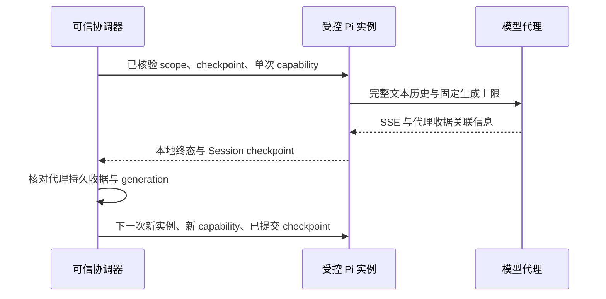

# M0 受控 Pi 与模型代理接线

本地适配器为 [proxy-pi.mjs](../services/runtime/proxy-pi.mjs)，类型见 [proxy-pi.d.mts](../services/runtime/proxy-pi.d.mts)。它把真实 Pi Session 接到已有模型代理的文本调用协议，供 G0-T01 的最小诊断使用。当前已验证本地独立 Pi 子进程接入固定 loopback/Workerd SQLite DO fixture；没有新增真实模型调用，没有部署该客户端，也不关闭 T01/T09。

## 调用与恢复

每个实例只允许一次 `prompt()` 和最多一次模型 transport 尝试。SDK 的鉴权预检与流请求可以多次解析凭据，但得到的是同一不可变 capability，不会逐次消耗新的调用 ID。完成后保存 checkpoint，下一调用由协调器创建新实例并恢复；旧实例不能通过第二次 prompt、重试或换模型重新派发。

`providerFetch` 是新增的受控宿主平台参数，优先于 SDK 调用选项。客户端核验最终 HTTPS origin、路径、POST 和准确的 Bearer；实际网络调用前重验取消信号与有效期，使用 `redirect: manual`，仅发送固定请求头。原供应商密钥和操作员管理 secret 不应注入 Pi；客户端只持有当前单次 capability。

完整 Session 的用户消息原本可能是文本 content parts 数组。最终 payload 检查将其按顺序合并成文本，同时保留 system、固定 Skill、历史 user/assistant 和本轮 user。超出文本范围的原始 checkpoint 在创建 SDK Session 前拒绝，避免 SDK 把图片静默替换为占位符。固定文本诊断不开放工具循环；完整建模 Agent 的工具协议仍属于后续接线工作。

## 取消、超时与证据

| 行为 | 客户端结果 | 仍需协调器核对 |
| --- | --- | --- |
| 正常完成 | 本地 completed；checkpoint 可取；重复 prompt 拒绝 | 代理持久终态、输入版本、generation 与提交收据 |
| 显式取消 | Pi 中断与 `/v1/cancel` 使用不同信号；同 capability，重复 cancel/dispose 共用一次请求 | 200 只表示取消接口确认，必须另外回读服务端账本和 active 状态 |
| 取消请求超时或失败 | `remote: unconfirmed`，不重发 | 保留未知状态及预算预留；不得直接换 capability 重放 |
| 模型请求或响应流超时 | 整个请求含 SSE body 受同一绝对时限约束；取消底层 reader，返回失败 | 供应商是否停止、最终用量与费用仍可能未知 |
| HTTP 错误或重定向 | 固定错误文本；不跟随重定向，不自动重试 | 原调用是否形成持久派发意图 |

客户端默认最多 8 KiB 正文、32 输出 token、30 秒完整模型请求、64 KiB 响应和 3 秒取消请求；构造参数也受硬上限限制。正文大小是传输边界，不能充当可计费 token 上界。真正的身份鉴权、预算原子预留、跨实例单写者、调用重放和终态持久化仍由平台协调器及模型代理负责。

`inspect()` 不返回 token。结果、checkpoint 和事件会清除当前已知 capability；文本流保留可能构成 capability 的未完成前缀，确认不是凭据后再交付，防止调用方拼接多个 delta 得到完整 token。正常文本的未完成前缀在文本结束时补发。此处理针对当前已知调用凭据，不是任意项目秘密的通用检测器。

SDK 模型成本字段是未定价的占位元数据；客户端 `billingAmount` 保持 `null`。本地 completed/aborted、取消接口确认、代理持久收据和供应商账单是不同证据，不能相互替代。

## 本地验证与发布边界

[集成测试](../tests/m0/pi/proxy-pi.test.mjs)使用锁定的真实 Pi SDK、回环 HTTP 服务、真实 capability/HMAC 验证和模型代理原语。模型结果由固定 SSE fixture 生成，存储使用串行内存事务；这不证明云 SQLite、VM 网络或真实模型记忆语义。

测试覆盖完整首次/恢复历史、两枚不同 capability、并行调用互不取消、提前取消、重复 prompt/cancel/dispose、HTTP 错误与重定向、响应头前后挂起、正文上限、跨 delta 凭据脱敏、图片 checkpoint 拒绝，以及实际 transport 微任务前取消。全仓检查和源码摘要另见[执行状态](development-status.md)。

此前 [23 项云 fixture](evidence/runs/m0-model-proxy-cloud-1788613210899-49e0a3db/model-proxy-cloud.json)证明的是已经部署的 Worker/DO 原语，运行时没有使用本客户端。此前[两份冻结镜像](m0-registry-alternative.md)也不包含本次接线变更；其既有 manifest 和公开范围继续作为历史产物记录，不能写成当前客户端的已构建或已部署版本。后续镜像必须更新白名单、COPY 与实际诊断入口后重新构建和核验。

新增的[本地 Pi/Workerd 收据](evidence/runs/m0-proxy-pi-local-1788622591199-4e3a43ff/proxy-pi-local.json)记录 10 项通过、2,380ms、7 次控制请求和 2 次 cleanup 请求；3 次模型流与 1 次同 call 取消在独立 child 进程中另计。首轮进程 close 后才落盘 0600/fsync checkpoint；实际 DO restart 后 nonce 变化但账本不变，新 PID 从盘恢复完整历史；取消后独立回读 terminal，所有 run 最终 `revoked` 且 `active=0`。父进程为每个 child 使用临时目录并在 close（包括 SIGKILL）后回收，child 不接收 operator secret。该 fixture 没有真实模型语义或回忆能力，不是云 Pi/VM、生产身份、真实供应商或 G0 通过证据；官方 T01 两轮候选也没有因此改成三轮。

[新 Linux 镜像](m0-pi-proxy-image.md)已包含代理客户端与固定 `--staging-fixture` 诊断入口，并在构建步骤禁网运行真实 SDK/两个独立 child 的首次与恢复检查。旧镜像记录不变；新镜像仍未上传或部署，当前 Sandbox 出口与云监督器尚未接入。
