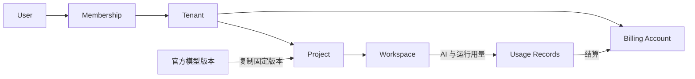
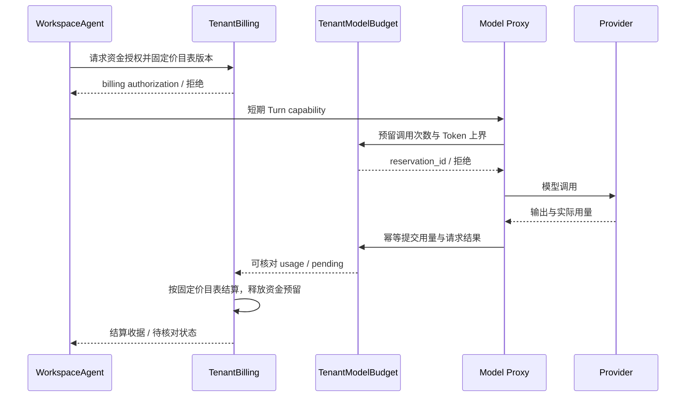

# 官方模型库、多租户与 Token 付费设计

日期：2026-09-07  
状态：产品设计基线；官方模型元数据、固定版本来源、规范包构建、私有 R2 resolver 与真实本地 Container 安装、provider Token/call 预算和私有代理链已有候选，云内容发布与资金账本待实现  
关联文档：[MVP 系统概要设计](mvp-system-design.md)

最新[真实产品 Turn 本地证据](evidence/runs/m2-product-turn-provider-disabled-20260907012455020/primary-review.json)已验证预算 DO、Model Proxy、双 Sandbox、R2 与三类真实容器在同一产品 release assembly 中工作：provider 门禁在预算预留前返回 503，用户侧事件明确记录错误，首轮失败终态与 Revision 保存后删除两个 Sandbox，第二轮从首轮 workspace 与 Session receipt 恢复到新 actor 并保存下一 Revision；两轮预算各为 `attempts=0`、`dispatchedCalls=0`。删除第二轮 Session blob 后，第三轮在 Sandbox 和预算分配前以 `turn-base-unavailable` 失败，不创建新 Revision，Workerd 重启后终态保持。验收使用生成的 provider-disabled 镜像，产品配置不含 `m0-*` 或 `Dockerfile.local` 依赖，Turn/provider 开关和活动 Trusted Pi release 仍失败关闭，因此此记录不代表真实模型调用、收费链路或云发布。

## 1. 产品决策与交付范围

官方仿真模型库提供可运行、可修改的建模起点；Tenant 拥有项目并承担账单；AI 服务按 Token 用量结算余额，仿真运行单独管理资源额度。用户从模型库创建项目后，仍进入极简 Session 界面。

本文中的“模型库”指仿真模型库，“模型供应商”指提供 LLM 推理服务的供应商，“Token”指供应商模型调用的用量单位。充值余额与 Token 数量分别记录，不将不同模型的 Token 合并为等价消费单位。

| 决策 | 首版约定 |
|---|---|
| 官方模型 | 基础模型免费浏览与复制，固定版本创建独立项目 |
| 技术主路径 | Python + SimPy；模型使用统一 Skill 与运行契约 |
| 租户关系 | User、Tenant、Workspace 分离；首先开放个人 Tenant |
| 项目归属 | Project 属于 Tenant，创建者作为操作主体单独记录 |
| 付费入口 | 首个付费版本支持预充值余额，按公开单价结算 AI 用量 |
| 运行费用 | 提供有上限的基础运行额度；超出后停止新增运行或购买扩容 |
| 消费保护 | 回合预算、调用前预留、实际用量结算、幂等入账与退款调整 |
| 后续能力 | 团队与教学空间、订阅套餐；不作为基础 MVP 的前置条件 |

### 1.1 阶段边界

| 阶段 | 必须交付 | 暂不开放 |
|---|---|---|
| 基础 MVP | 个人 Tenant、独立 Workspace、机场 Starter 固定版本、真实用量记录、资源额度 | 在线支付、团队成员管理、订阅 |
| 首个付费版本 | 官方模型目录与版本发布、充值、余额与账本、预算控制、账单查询、退款调整 | 第三方模型市场、复杂团队权限、多币种钱包 |
| 后续版本 | 根据客户需求增加团队或教学空间；依据实际用量设计订阅 | 不预先承诺上市时间或全部实现 |

官方模型目录与支付模块扩展基础 MVP，Workspace / Session / Run 的核心执行与恢复语义保持一致。目录元数据、状态机、规范包构建、冻结内容的私有读取/摘要验证以及受限 JSON 内容包安装已有真实本地纵切；云端上传发布、云 Container、支付和资金结算仍为待实现要求。

### 1.2 当前实现边界

2026-09-07 已实现的本地候选覆盖平台侧完整调用边界：Tenant 范围的 SQLite `TenantModelBudget`、由 Trusted Pi outbound 按实际容器与完整 Turn 身份签发的短期 capability、Sandbox 到私有 Model Proxy 的请求 MAC、provider 派发前的一次性 fence，以及固定 OpenCode Go Responses 端点和 `gpt-5.6-luna` 的 provider adapter。它记录 reservation attempt、实际 dispatch 次数、输入上界、最大输出、已确认 usage 和待核对状态；Runtime 重建或 `dispatchId` 变化不能重置同一 Turn 的额度。provider 的 SSE 在受限内存中读完并验证唯一 completed/incomplete 终态、request ID 与 usage 后才结算，再按原始字节返回；成功响应缺少可核对 usage 时失败关闭。

这不是收费系统。当前实现不含价格、币种、余额、充值、订单、退款或 `TenantBilling`；Pi SDK 模型元数据中的零成本字段只用于满足适配器结构，任何预算和未来账单都不得读取它。完整本地 Wrangler 候选声明预算 DO、双 Sandbox、Tool Bridge、Model Proxy、R2 与三个容器类型，但 `M2_TURNS_ENABLED=false`、`M2_MODEL_PROVIDER_ENABLED=false`，活动 Trusted Pi 镜像仍加载失败关闭模块；OpenCode Go 凭据未写入配置，未部署云端，也没有新增模型调用。[契约证据](evidence/runs/m2-model-budget-local-20260907/primary-review.json)与[Workerd Durable Object 证据](evidence/runs/m2-model-budget-workerd-local-20260907/primary-review.json)签收早期 Token/call 原语；[产品发布链本地证据](evidence/runs/m2-product-release-chain-local-20260907/primary-review.json)签收本次固定 provider、平台能力票据、Pi transport、六个远程工具、Runtime 组装、完整拓扑和失败关闭镜像。

官方模型库本地纵切新增第 6 个 D1 迁移与 Gateway：公开用户只能读取 `published` 模型的脱敏元数据；operator 可列出全状态版本并执行 `draft → validated → published → withdrawn`；数据库禁止状态回退和发布后修改内容，生命周期事件写入独立追加审计。每次 operator 创建/变更都有持久幂等 intent。项目创建支持 `{modelId, modelVersion}`，把版本与内容来源冻结到 Outbox；撤回阻止新请求，但既有 Outbox 继续使用同一冻结来源。`m1:model-package` 受控构建器从允许目录生成排序、无空白差异且字段顺序固定的规范 JSON，拒绝符号链接、硬链接、特殊文件、非 NFC/越界路径、超限与覆盖输出，并用 0600 写包，只返回包级摘要。ProjectRuntime 从固定 `model-content/` namespace 读取最多 8 MiB，回读全部字节并重算包摘要，只接受该唯一字节表示、规范 Base64 和逐文件 SHA-256。固定安装程序通过有界 `stdin` 接收清单与原始字节，拒绝现存硬链接，使用独占临时文件、`fsync` 与原子 rename。Runtime 在启动前持久化安装意图和小型 receipt/manifest；完整安装但响应丢失时由文件检查确认，不重复安装，半安装只重新解析同一冻结引用并幂等补齐，撤权、到期或 fence 后停止修复。WorkspaceAgent 与 Catalog 分别严格校验可选模型收据并与 Outbox 冻结来源比对，空白项目不能夹带模型收据。[真实本地模型内容链路](evidence/runs/m1-workspace-20260907063137662/workspace-local.json)经 Gateway、D1、DO、两个 R2 binding 和原生 Docker 安装 392-byte/2-file 包，生成绑定模型来源的 checkpoint 后停止并投影 `ready`。生产用户端和管理端已接目录元数据，但云 `MODEL_CONTENT` bucket/binding、operator 上传发布、迁移和双身份隔离仍未完成。

内容包本地接线已经形成端到端候选：客户端和项目内 Pi 都不能提供 ref、内容字节或解析规则；读取、解析、安装、收据投影或读回不一致均失败关闭，旧 `blank-v1` task 不进入内容包路径。下一阶段是把现有受控构建器接入 operator 上传发布、创建云 binding，并做云容器与双租户验收。

## 2. 官方仿真模型库

### 2.1 用户体验

“新建项目”提供空白项目与官方模型入口。模型详情展示场景、假设、可调参数、输出指标、预览、运行要求和验证记录。用户选择固定版本后点击“使用此模型”，系统在当前 Tenant 中创建 Project 和 Workspace。

免费浏览使用说明、截图或录制演示；真正执行模型进入用户自己的 Workspace，计入运行额度。复制模型与直接运行已有代码不会触发 LLM 调用；用户请求 Agent 解释、修改或分析时才产生相应 AI 用量。

首批模型以少量完整案例覆盖排队、资源调度、库存等问题。基础 MVP 保留机场保障 Starter；扩充目录优先保证模型质量，数量不作为退出指标。

### 2.2 模型版本内容

| 内容 | 要求 |
|---|---|
| 标识与版本 | 稳定 model_id、明确 version、发布状态、内容摘要 |
| 场景与假设 | 问题定义、适用范围、限制和数据来源说明 |
| 模型代码 | 可编辑源码、入口和固定依赖；使用统一运行契约 |
| 参数与指标 | 参数类型、默认值、单位、合理范围、输出 schema |
| 交互与实验 | 交互应用、示例实验计划、种子及指标解释 |
| 验证证据 | 最小运行、固定种子检查、基本不变量与已知限制 |
| 使用权限 | 作者、许可证及修改、导出、再分发的明确边界 |

发布包只包含预期分发的代码、说明、示例数据及经审核的示例结果，不包含用户对话、凭据、私人数据或运行临时文件。工程验证表示代码满足发布检查，不能替代模型校准或科学有效性判断。

### 2.3 版本发布与复制

官方目录由平台维护，发布流程为 `draft → validated → published`，可将有问题的版本标为 `withdrawn` 并阻止新建使用。已发布内容不可原地覆盖，修改必须产生新版本。

创建项目时记录 `source_model_id`、`source_model_version` 和 `source_digest`，复制代码与配置并生成初始 WorkspaceRevision。项目自己的修改不写回官方版本，也不影响其他项目。

官方模型只读资产可以共享存储；可写文件、Pi Session、实验和 Browser 状态归各 Workspace 独立持有。复制操作使用幂等请求键，失败可重试，不能重复创建项目或留下半初始化的可用状态。

官方发布新版本时，已有项目不自动更新。首个付费版本可提示新版本，并支持从新版本另建项目；自动合并用户修改不纳入首版。撤回版本不静默删除用户已经创建的项目。

### 2.4 商业边界

基础官方模型免费浏览和复制，持续建模与云端运行服务承担首版收入。付费购买的是实际提供的服务，复制项目不隐含单独的模型许可收费。

若以后增加收费专业模型，应另行定义内容许可和服务权益，不能通过限制用户已获授权的项目编辑、运行或导出来改变既有规则。第三方投稿、销售分成与插件市场不进入当前设计。

## 3. 多租户与项目归属

### 3.1 核心关系



| 概念 | 定义 |
|---|---|
| User | 登录和实际操作的人，具有稳定用户标识 |
| Tenant | 项目、成员、配额与账单的归属空间 |
| Membership | 用户在某 Tenant 内的成员身份与权限 |
| Project | 长期项目，归 Tenant 所有，单独记录创建者 |
| Workspace | 项目文件、Session、进程与插件的隔离边界 |
| Billing Account | 对应 Tenant 的余额、预留、消费、退款及账单 |

首次注册创建个人 Tenant 与 owner Membership。个人用户只看到自己的空间，无需面对组织管理界面；关系模型不限制一个 User 永远只属于一个 Tenant。

### 3.2 租户模式

| 模式 | 数据与预算关系 | 开放阶段 |
|---|---|---|
| personal | 个人拥有空间，管理自己的项目和余额 | 基础 MVP |
| team | 团队拥有项目与账单，成员具有项目授权和消费额度 | 后续按需求开放 |
| education | 教学空间统一预算，学生作业分别授权和隔离 | 后续按需求开放 |

团队共享账单不自动授予所有项目访问权。项目访问、发起消费、管理预算分别授权；团队成员退出后，项目与消费记录仍属于团队。班级预算不隐含学生之间互读作业，教师访问也由显式教学角色授权。

成员角色和教学功能在对应阶段确定。基础 MVP 只需个人 owner 与独立的平台运维权限，不提前建设完整 RBAC 管理界面。

删除 Project 会清理项目内容并停止所属任务，但保留必要的支付、用量结算、退款及审计记录，遵守上线时明确的保留政策。项目删除不撤销已发生的消费，不删除整个 Tenant 的余额或账本。

### 3.3 请求与运行隔离

每次请求从已验证的 User、目标 Tenant Membership 和 Project ACL 确定授权，不能仅凭客户端 active_tenant_id 放行。Project、Workspace、Session、Run 和 Artifact 必须属于同一条授权链。

新建 Turn / Run 时固定 `tenant_id`、`actor_user_id` 和计费账户。用户切换当前空间后，已开始的任务继续归原空间；客户端切换不能改变任务的归属或扣费对象。

控制面和官方模型目录可共享部署；每个 Workspace 使用独立 Sandbox。成员身份、项目权限与资源策略由服务端判断，不为每个 Tenant 复制整套服务，也不跨 Workspace 共享可写项目目录或 Agent 会话。

## 4. AI 用量与运行额度

### 4.1 对用户的收费单位

用户充值余额，AI 调用按执行前公开的价目表结算。余额、Token 用量与供应商成本分别记录。账单按项目和 Agent 回合汇总，允许展开查看模型、计费类别、实际用量、单价和金额。

```text
AI 费用 = Σ（各模型、各计费类别的实际用量 × 对应平台单价）
```

价目表声明计量单位，例如每百万 Token 的金额，并具有不可变版本。不同模型、普通输入、缓存输入、输出等按供应商实际语义归类；推理 Token 等可能属于已有总量的子集，不能重复相加。一个 Token 数量未知的响应不能按零用量处理。

供应商成本用于经营分析，平台单价用于用户结算。执行请求前固定价目表版本，不能因为供应商调价或内部路由变化对已执行请求追溯提价。首版使用一个主供应商，不承诺固定数量 Token 等价于固定次数建模。

账本使用确定精度的整数金额，明确汇总与舍入规则，不用浮点余额。具体币种与价格在选择支付渠道和测出实际成本后确定；首个付费版本只采用一种结算币种。

### 4.2 消费归因

| 操作 | AI 用量 | 运行 / 存储额度 |
|---|---|---|
| 浏览模型说明与录制演示 | 无 | 平台承担受限的浏览服务成本 |
| 复制官方模型 | 无 | 占用项目存储 |
| 直接运行既有模型或 Preview | 无，除非任务显式调用 LLM | 计入运行额度 |
| Agent 解释或修改项目 | 按实际模型调用 | 工具执行计入运行额度 |
| 批量仿真 | 纯仿真无 AI 用量 | 按实际运行占用额度 |
| Agent 分析实验结果 | 按实际模型调用 | 读取与分析使用相应资源 |

本地文件读写工具本身不产生 Token 账单，但工具结果被送入下一次 LLM 请求时可能构成输入用量。计费说明应覆盖上下文和多次工具循环，避免把一次用户消息等同于一次模型调用。

### 4.3 基础运行额度与后续订阅

首个付费版本采用充值余额支付 AI 服务，同时提供明确上限的基础运行额度。额度至少约束运行时长、实例规格、并发和存储。超额后拒绝新增工作或提供明确扩容入口，不静默从 AI 余额扣除未公布的运行费用。

已开始的任务遵守预先声明的运行上限，在可用资源内保存结果并停止；停止成本与保存空间计入平台预留。余额不足不阻止用户在既定保留期内查看、下载和导出已保存文件与结果，但不能继续启动付费 Agent 或超额计算任务。

后续订阅可包含存储、并发、运行额度和部分 AI 余额，额外消费按公布规则购买。具体套餐、运行计量单位、余额有效期、数据保留期和扩容价格在真实使用数据与渠道约束明确后确定，并须在收费上线前公开。

Cloudflare Sandbox 的底层成本包括 Containers 资源和相关 Workers / Durable Objects 服务，运行开销不能仅靠 Token 数量衡量。[Sandbox 计费说明](https://developers.cloudflare.com/sandbox/platform/pricing/)

## 5. 余额、预留与结算

### 5.1 权威账本

每个 Tenant 的 Billing Account 规划使用独立的 TenantBilling Durable Object 作为串行协调者；它拥有余额、资金预留与结算的权威写入。D1 中的账单列表与统计为查询投影，不通过多个 Workspace 各自修改余额。当前本地 `TenantModelBudget` 只处理调用次数和 Token 上界，不能作为 TenantBilling、现金余额或收费已上线的证据。

金额变动以追加账本记录表示，包括充值入账、消费结算、退款和明确的调整。可用余额等于已入账净额减去有效预留。消费记录关联 Tenant、用户、Project、Workspace、Turn、模型请求 ID、实际用量及价目表版本。

充值与消费凭据由服务端管理，项目进程不能调用入账或修改余额操作。跨 Workspace 并发请求统一向本 Tenant 的账本申请额度。

### 5.2 充值流程

1. 用户在当前 Tenant 创建充值订单，服务端固定金额、币种和收款账户。
2. 用户完成支付，支付服务发出通知。
3. 服务端验证通知签名、订单归属、金额、币种与支付状态，必要时主动查询支付服务。
4. 以支付交易标识幂等入账，展示订单和余额。

浏览器支付成功跳转不能直接增加余额。重复、乱序或延迟通知不能重复充值；不明确的支付状态进入对账流程。付款退款与服务补偿分别记录，不删除原订单或原消费历史。

### 5.3 调用前预留与结束结算



每个 Agent 回合有预算上限；回合内每次 LLM 调用根据已知输入和最大输出申请保守 Token 预留，收费版本还需按固定价目表申请资金授权。Model Proxy 只执行同时满足 capability、Token/call 预算及资金授权的调用，并约束请求参数不超过授权范围。

只有可验证用量与计费边界的调用进入首版付费路径。已确认实际金额不得突破用户授权上限；由平台估算错误或内部重复调用造成的差额由平台承担。

预留、派发与模型调用不构成跨服务事务。崩溃后先按请求 ID 对账，未派发的预留可释放；已经派发但结果未知的请求进入待核对状态，不能仅因租约到期就重复调用或释放后再次花费同一笔额度。

重复响应、事件回放与支付通知均按稳定标识去重。请求幂等标识相同而内容不同应拒绝，不能复用预留执行另一项消费。

### 5.4 取消、失败与补偿规则

| 情况 | 结算约定 |
|---|---|
| 尚未派发就取消 | 释放预留，不产生模型消费 |
| 正常探索或用户中途取消 | 结算已确认实际用量，释放未使用额度 |
| 平台错误造成重复调用 | 用户不承担重复消费，已扣金额通过调整记录退回 |
| Provider 返回错误 | 根据实际调用与用量证据处理，不因 HTTP 错误自动推断零费用 |
| Usage 缺失或执行结果未知 | 展示待核对，保留必要预留；不猜测金额、不自动重放 |
| 回合到达预算或可用余额不足 | 停止发起下一次调用，保存已有状态，Turn 进入 waiting_input 并记录原因；用户补充余额或调整预算后显式继续 |

服务是否达到用户期望与 Token 是否实际发生分别记录。平台承担的补偿保留原因和原消费关联，账单展示最终净费用。待核对记录需要明确的处理时限与人工处理入口，不能无限冻结用户余额；具体时限在付费上线前确定。

### 5.5 Cloudflare AI Gateway 的位置

AI Gateway 用于供应商接入、用量观察和成本保护。其成本指标属于估算，准确成本需与供应商记录对账。[AI Gateway 成本指标](https://developers.cloudflare.com/ai-gateway/observability/costs/)

Gateway 的 spend limits 可以设置预算，但采用最终一致性，并发请求可能短暂超额。因此这些限制作为平台成本防护，用户余额仍由 TenantBilling 的预留与结算控制。[AI Gateway 预算限制](https://developers.cloudflare.com/ai-gateway/features/spend-limits/)

## 6. 模块与最小数据对象

| 模块 / 对象 | 责任 |
|---|---|
| Model Catalog / ModelVersion | 官方模型说明、版本、发布状态和内容引用 |
| Project Provisioning | 验证模型版本与成员身份，幂等复制并保存初始版本 |
| Membership / Project ACL | Tenant 成员身份、项目访问和消费权限 |
| Billing Account / TenantBilling | 余额、跨 Workspace 原子预留与结算 |
| PriceBookVersion | 模型类别、单位、平台单价、启用时间和不可变版本 |
| PaymentOrder / LedgerEntry | 充值订单、支付交易、追加账本与退款调整 |
| UsageRecord / Reservation | 请求级用量、预算占用、结算收据与待核对状态 |
| Usage & Billing UI | Tenant 余额、项目 / 回合消费、运行额度、订单与退款 |

所有涉及资金和身份的上下文由服务端生成。跨服务投影失败通过对账重建，不用 UI 显示的余额或 Gateway 汇总统计覆盖权威账本。

## 7. 付费版本验收

| 场景 | 必须通过的结果 |
|---|---|
| 官方版本复制 | 两用户从同一模型创建项目；修改其中一个项目不改变官方版本或另一项目，各项目可独立修改 |
| 发布与撤回 | 新版本不覆盖旧项目；撤回阻止新建，不删除用户项目 |
| 租户归属 | 篡改 Tenant / Project / Billing 标识不能读数据、发起消费或操作余额 |
| 空间切换 | 执行中切换 Tenant 不改变既有任务和消费的归属 |
| 充值幂等 | 伪造浏览器成功页不能入账；重复支付通知仅入账一次 |
| 并发预算 | 多个 Workspace 同时调用不超出已授权余额和 Tenant 预算 |
| 结算准确 | Token 分类不重复计数；执行时价目表可追溯；舍入规则确定 |
| 中断与回放 | 请求、通知和事件重复投递不重复消费；未知结果不自动重放 |
| 取消与补偿 | 未执行额度释放；已确认消费可核对；平台重复费用被补偿 |
| 无 AI 运行 | 复制与直接运行模型不产生虚构 Token 消费，运行额度真实扣减 |
| 余额不足 | 不再启动付费调用；已保存内容仍按保留政策可读、可导出 |
| 项目删除 | 删除项目文件与产物，不删除 Tenant 余额、必要的支付和结算审计记录 |

## 8. 上线前待定事项

首批付费用户、支付渠道、结算币种、Token 单价、基础运行额度与价格、余额有效期、数据保留期、退款条件及对账处理时限尚未确定。它们是上线配置与商业政策决策，不在本文虚构数值，也不触发自动购买或开通服务。

先记录真实任务的 LLM 成本、运行占用、存储和故障补偿，再确定首批价格。团队与教学模式的优先级由首批客户需求决定。

本文整理自当前讨论，平台计费能力链接于 2026-09-05 核对。本文只定义产品要求，不代表任何支付、扣费或收费服务已经上线。
