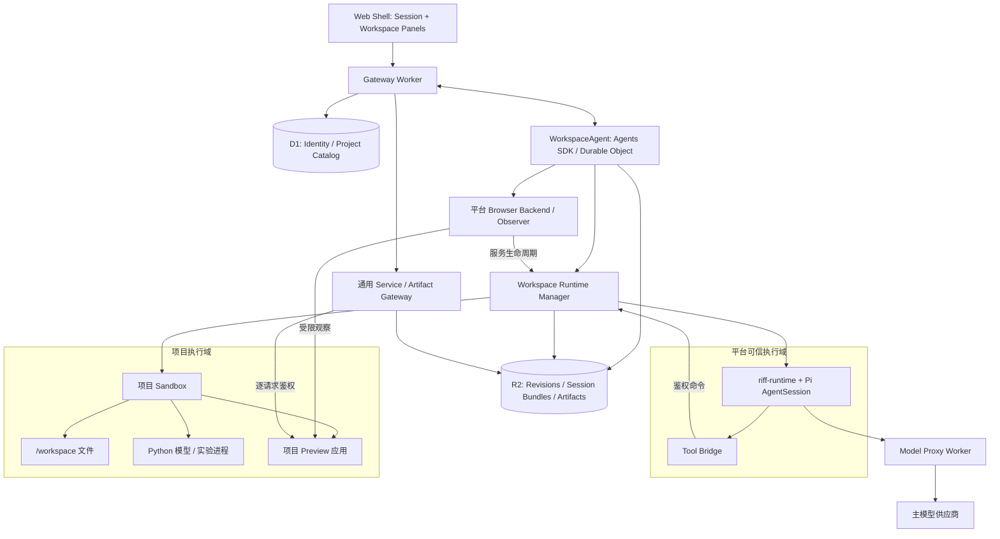
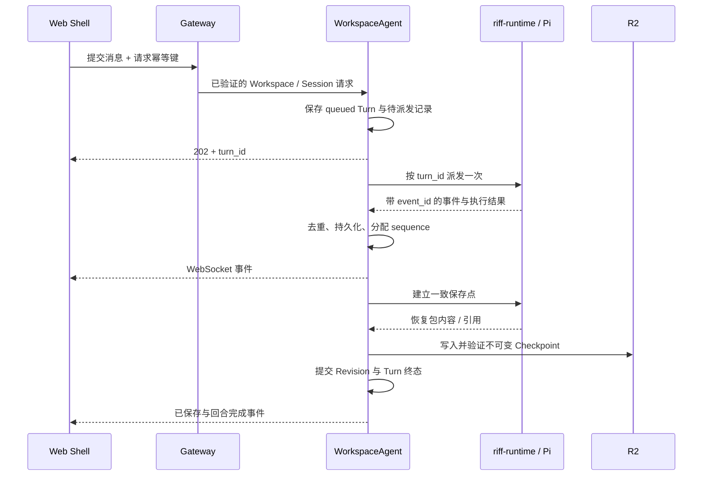

# Riffology Cloud MVP 系统概要设计

日期：2026-09-05  
状态：设计基线；功能与验收均待实现  
适用范围：本仓库的首个可用产品

设计讨论：[评估pi-web重构路线](chatgpt-conversation://6a9a2984-6dc4-83ec-af1f-c17ad1f0b4bb)

配套设计：[官方模型库、多租户与 Token 付费](model-library-tenancy-billing-design.md)、[平台功能与项目内 Pi Agent 构建边界](platform-project-boundary.md)。本文定义基础 MVP；官方模型目录与在线支付按配套文档扩展到首个付费版本。

## 1. 产品定义与范围

Riffology Cloud 是一个多租户、持久化的 Pi Agent Workspace 服务，首个产品场景是 Python 仿真建模。用户在项目内用自然语言创建和修改模型，运行仿真，查看结果，并在后续 Session 中继续工作。

主界面采用 PI WEB 风格的极简 Session 交互。Workspace 提供文件、运行和插件能力；Browser 是可选内置插件，负责交互预览和 Agent 观察。关闭 Browser Panel 后，对话、文件和实验仍可正常使用。

本设计作为独立产品基线。实现不承担既有系统的接口兼容、数据迁移、部署复用或历史功能对等要求。

### 1.1 基础 MVP 必须交付

| 能力 | 首版边界 |
|---|---|
| 用户与项目 | 邀请制；默认创建个人 Tenant 与 owner Membership；项目归 Tenant，首版仅个人所有者访问 |
| Workspace | 一个 Project 一个 Workspace；文件持久化；独立 Sandbox |
| Agent | Pi；一个平台配置的主模型供应商；流式事件、取消、重连和上下文恢复 |
| Session | 一个 Workspace 可有多个 Session；同时执行一个 Agent Turn |
| 文件 | 查看、上传、下载、单回合变更列表和文本 Diff；Agent 默认可写项目目录 |
| 仿真 | Python + SimPy；固定 Simulation Skill；空白项目和一个固定版本的官方机场保障 Starter |
| 运行 | 单次运行、有限批量实验、真实进度、日志、停止和持久化结果 |
| Browser | 启动与嵌入 Preview；截图、页面快照、console；可按 Workspace 禁用 |
| 运维 | 资源额度、超时、故障分类、恢复入口、审计与管理员停止能力 |

基础 MVP 不纳入团队协作、公开分享、插件市场、任意插件安装、多 Agent、多模型选择 UI、BYOK、完整 IDE、Git 同步、第三方模型市场、多个仿真框架和在线支付。首个付费版本增加官方模型目录、版本发布、充值余额及用量账本；团队 / 教学空间与订阅随后按需求开放。

### 1.2 产品成功标准

不同用户能够在各自的 Workspace 中完成“描述需求 → 修改模型 → 运行与观察 → 追问或实验 → 再次打开继续工作”，且文件、运行、事件和凭据保持隔离。

可运行与可恢复属于工程验收。模型假设、校准和科学有效性由具体项目另行论证，系统不以运行成功替代这些判断。

## 2. 核心设计决策

| 决策 | 设计约束 |
|---|---|
| Session 是主要交互入口 | 打开项目进入最近 Session；辅助 Panel 按需打开 |
| Workspace 是执行与持久化边界 | 文件、Pi 上下文、运行和插件实例均归属于 Workspace |
| WorkspaceAgent 是单一协调者 | 串行决策 Turn、运行、版本提交、休眠与恢复 |
| Tenant 是资产与预算归属 | User 通过 Membership 访问 Tenant；个人模式不限制长期关系模型 |
| 付费账本由 Tenant 统一协调 | 首个付费版本使用 TenantBilling 预留与结算余额；WorkspaceAgent 不单独扣款 |
| Pi 负责 Agent loop | Cloudflare Agent 负责持久状态和调度；不再建立第二套 LLM 对话循环 |
| 平台能力与项目产物分层 | Pi Runtime、固定 Skill、工具及 Browser 由平台发布；Agent 编辑项目模型、应用和实验，并调用受控平台能力 |
| Sandbox 提供热运行环境 | 文件的长期依据是 R2 中已提交的版本，容器可重建 |
| Browser 是插件 | 核心只识别插件贡献点、操作、实例和通用服务；Preview / DOM 语义留在插件内 |
| Run 属于核心 | 命令、仿真、实验和服务进程有统一登记、日志、停止与资源管理 |
| 状态确认以持久化为准 | “运行中”“工具已执行”“文件已保存”“结果已保存”具有不同含义 |
| 首版采用单一技术实现 | Pi + Cloudflare Sandbox；不预建多个 Agent Host 或云运行时适配器 |

PI WEB 的 Project / Workspace / Session 组织方式作为交互参考，产品的身份、权限和运行生命周期由本系统定义。[PI WEB 项目说明](https://github.com/jmfederico/pi-web)

## 3. 总体架构



### 3.1 部署单元

| 单元 | 内容与责任 |
|---|---|
| Web 静态资源 | Session 界面、Files / Changes / Runs Panel、Plugin Panel Host |
| Gateway Worker | 身份认证、ACL、API、WebSocket 入口、服务与产物代理 |
| WorkspaceAgent | 每个 Workspace 一个持久 Actor，维护状态机和协调决策 |
| Sandbox 管理层 | 启停独立 Linux 环境、执行控制请求、恢复目录与管理进程 |
| riff-runtime | 可信 Node Pi 宿主和 Tool Bridge；通过受鉴权控制接口操作独立项目执行域 |
| 项目执行域 | Python 模型、依赖、实验与 Preview 应用；运行登记和保存收据仍由平台确认 |
| Browser 后端与 Observer | 平台内置服务生命周期和观察能力；与项目应用及其状态分开 |
| Model Proxy | 注入供应商凭据、执行模型额度和超时策略；可与 Gateway 同部署 |
| D1 | 身份、项目目录、权限及可重建的查询索引 |
| R2 | 不可变文件版本、Pi Session 恢复包、日志分段和产物 |

Cloudflare Agents 提供持久身份、SQL 存储、实时连接和调度能力，适合作为 Workspace 控制面。本产品仍需实现外部 Pi 进程的派发、租约和故障对账。[Agents 文档](https://developers.cloudflare.com/agents/)

Sandbox SDK 已包含管理容器的 Durable Object。WorkspaceAgent 管理业务状态，通过 SDK 调用 Sandbox；不重复实现容器基础设施。Sandbox 提供独立 VM 中的 Linux 运行环境。[Sandbox 架构](https://developers.cloudflare.com/sandbox/concepts/architecture/)

执行边界以[ADR 0001](adr/0001-pi-project-trust-boundary.md)为准：可信 Pi / 控制执行器与项目代码分处不同执行信任域。图中的管理入口由平台绑定具体项目，项目不能自行扩展寻址范围。M0 必须在所选版本和真实部署环境证明：项目命令不能读写权威 Pi 恢复包与控制目录、触达可信控制 RPC、继承敏感环境或取得跨项目权限。分离拓扑已经选定，云端隔离尚待验收；通过 G0 后才进入 M1，继续采用单一云平台。

首版由 WorkspaceAgent 的持久队列、alarm 和 Runtime Supervisor 驱动作业。Cloudflare Workflows 不作为首版的必需部署单元。

## 4. 功能模块

### 4.1 Web Shell

桌面端保留项目 / Session 导航、对话区和可折叠 Workspace Panel。顶部只显示项目、当前模型和工作状态。

```text
┌──────────────────────────────────────────────────────────────┐
│ Project                 Model              Workspace Status │
├──────────────┬───────────────────────────┬───────────────────┤
│ Projects     │ Session                   │ Workspace Panel   │
│  Project A   │                           │                   │
│   Session 1  │ Messages                  │ Files / Changes   │
│   Session 2  │ Tool cards                │ Runs / Logs       │
│  Project B   │ Errors / Run cards        │ Browser           │
│              │                           │                   │
│ + Project    │ Composer                  │ 按需打开           │
└──────────────┴───────────────────────────┴───────────────────┘
```

Panel 默认关闭，宽度可调整。移动端使用 `Session | Workspace` 两个页签。Browser 就绪时可自动打开一次，关闭 Panel 不等于停止 Preview，也不等于禁用插件。

Composer 支持文本、文件附件和当前插件上下文。附件经鉴权与大小检查后写入当前 Workspace。状态条区分连接状态、Workspace 状态、Turn 状态和 Run 状态。

Files 提供文件树与预览；Changes 显示回合起始版本到最终保存版本的差异。Runs 提供进度、日志、产物和停止入口。MVP 的命令入口复用 Runs，不单独建设完整交互 Terminal。

### 4.2 Identity 与 Project Catalog

Gateway 验证登录 User、目标 Tenant 的 Membership 和 Project ACL，不信任客户端提交的 `tenant_id` 或 owner 信息。Project 属于 Tenant，单独记录创建者；Project 与 Workspace 的关联由服务端创建并校验。

基础 MVP 的个人 Tenant 所有者可以使用本空间项目；后续共享预算不自动授予项目内容访问权限。平台管理员可查看运维状态、调整额度和停止任务。本计划不开放管理员身份读取用户项目内容，诊断使用脱敏元数据；将来若增加内容协助，须另行实现用户授予的项目范围、期限、撤销和审计，不能从运维角色推导权限。

D1 负责用户、邀请、租户、Membership、项目、Workspace 目录和 ACL。Project 创建使用幂等请求；运行环境未就绪时项目显示 `provisioning`，允许继续查询或重试。Turn / Run 创建时固定 Tenant 与操作用户，切换当前空间不能改变已有任务或消费归属。

### 4.3 WorkspaceAgent

每个 Workspace 对应一个 WorkspaceAgent，名称从服务端已验证的 Tenant / Workspace 标识派生。WorkspaceAgent 是该 Workspace 状态的权威写入者。

它负责 Session 元数据、Turn 队列、事件序号、Revision 收据提交、Sandbox 生命周期、Run 协调、Plugin Binding、取消与故障对账。不可变 Revision 对象由私有 RevisionStore Durable Object 独占 R2 读写；WorkspaceAgent 只有在收据通过校验并写入本地事务后，才更新 workspace/session head 和已保存终态。D1 中的 Session / Run 列表摘要作为异步查询索引，不能反向覆盖权威状态。

TurnJournal 的可观察事件是有界窗口，Turn start/terminal sequence、workspace/session head、请求 intent 和 runtime event receipt 独立持久化。客户端游标早于窗口时必须先重读 Workspace 快照；服务端发送 `snapshot.required` 并关闭旧流，不能静默跳到新事件。

首版并发规则如下：

| 活动 | 每 Workspace 限制 |
|---|---|
| Agent Turn | 一个执行中；其他 Session 的 Turn 排队 |
| 文件修改 | 同一时刻一个写入者；上传、Agent 工具、命令均经过同一协调边界 |
| Experiment | 一个执行中；基于已提交 Revision 的独立工作副本 |
| Browser Preview | 一个活动实例；绑定已提交 Revision |
| 查看文件、日志与结果 | 可并行，不占写锁 |

Preview 和 Experiment 只读输入版本，写入各自输出目录；因此可与下一次 Agent 修改并行。所有资源仍共享 Workspace 总配额。

### 4.4 Pi Agent Runtime 与 Tool Bridge

`riff-runtime` 在 Node 进程中使用 Pi `AgentSession`，负责上下文、模型调用、工具调用、取消及 Session 恢复。Pi SDK 提供嵌入式 Session、事件订阅、自定义工具和 Session 存储入口。[Pi SDK 文档](https://github.com/earendil-works/pi/blob/main/packages/coding-agent/docs/sdk.md)

Pi Runtime、Simulation Skill、Tool Bridge 和启用插件的工具均由平台随产品版本发布，使用明确的加载清单。项目 Agent 调用这些能力来构建项目产物，不修改它们的实现。项目文件不会自动注册平台扩展、插件或供应商凭据。可编辑路径、受保护控制面及项目声明契约见[职责文档](platform-project-boundary.md)。

集成时提供受控 ResourceLoader，禁用项目可执行扩展的自动发现；项目与祖先路径中的 Skill、指令，以及 agentDir 的模型、设置、凭据来源按显式策略加载。Session 恢复重新验证当前模型和插件白名单，不能恢复已被撤销的工具权限。SDK 的具体参数在锁定版本的技术验证中确认，不能仅凭设置工作目录宣称完成隔离。

Tool Bridge 暴露以下能力组，具体函数签名在实现时确定：

| 能力组 | 操作 |
|---|---|
| workspace | read、write、edit、list、search、checkpoint |
| process | exec、start、stop、status、logs |
| run | create、status、stop、results |
| plugin | invoke |

普通项目文件操作默认允许。读写工具校验规范化路径、符号链接目标及目标类型；Shell 通过受限操作系统身份、文件挂载、进程边界和网络策略执行。工具层的路径检查不被当成任意 Shell 的安全沙箱。

项目代码可以读取运行所需的系统库，写权限限于项目目录与受配额约束的临时 / Run 输出目录。平台 Session 恢复数据、控制通道与凭据不交给项目命令修改。

### 4.5 Workspace Runtime Manager

Runtime Manager 提供本产品所需的 provision、restore、exec、process、checkpoint、service 和 stop 操作，封装一个 Cloudflare Sandbox 实现。

进程监管登记 PID、进程组、所属 Turn / Run、启动时间、退出码和资源限制。取消短命工具时终止其进程组；独立 Run 由自己的停止操作控制。后台写进程不得脱离 Run 登记后继续修改项目。

活动 Turn 或 Run 持有有期限的运行租约，管理器维持所需 runtime 活动状态。浏览器连接不能作为保活条件。无活动任务时才允许进入休眠流程，休眠必须经过保存与对账。

### 4.6 Run Manager 与 Simulation Skill

Run 是执行记录，首版类型为 `command`、`simulation`、`experiment` 和 `service`。Browser 将 Preview 关联到 `service` Run，核心不需要特殊的 `preview-process` 类型。

每个 Run 必须记录：Workspace、输入 Revision、参数、命令或入口、依赖锁摘要、runtime 镜像版本、发起 Session / Turn、状态、日志位置、产物、开始 / 结束时间和错误。长驻服务停下时为 `stopped`；有限任务验证输出并保存后为 `completed`。

项目提供模型入口、参数 schema、实验计划、种子清单和领域指标；平台验证并固化计划，负责资源检查、调度、进度确认、停止与产物发布。Runs Panel 消费通用 Run 记录，不包含机场等特定模型的固定业务参数。`simctl` 的受控入口和协议由平台实现，具体领域计算代码来自绑定 Revision 的项目。

Simulation Skill 保留 Python + SimPy 的项目约定、可复现要求、建模假设与有效性边界，不规定每次任务必须执行的固定建模步骤。既有项目沿用现有结构；新项目使用 `model/`、`app/`、`experiments/`、`results/` 和 `docs/`。通用验证与结果报告要求由 system prompt 统一承载。

`simctl` 实现时，Skill 仅说明适用场景与完成条件，参数 schema、详细协议和示例由工具描述及按需参考文档承载，执行约束由平台校验。拟实现的命令契约如下：

| 命令 | 责任 |
|---|---|
| `simctl check` | 检查入口、配置、依赖和最小运行 |
| `simctl run` | 执行一个参数与随机种子明确的模型实例 |
| `simctl experiment` | 执行显式实验计划并持续输出实际完成记录 |
| `simctl preview` | 启动可交互的模型服务，由 Browser 插件托管 |

这些是拟实现的产品命令，不代表仓库已有可执行程序。

批量实验开始前固化参数组合与种子清单。每个子任务记录唯一标识、种子、参数、状态和产物；固定种子用于复现，需要随机重复采样时生成并保存互异种子。进度显示 `planned / completed / failed / cancelled`，计数来自子任务结果。

完成数量以模型输出校验和持久化收据为准。部分失败必须展示失败数；停止后的已保存子任务结果仍可查看。整体实验的默认成功条件是所有计划子任务成功，允许部分成功的策略须在实验配置中明确。

## 5. 核心对象与状态归属

```text
User ── Membership ── Tenant

OfficialModel ── ModelVersion ── 复制到 Project

Tenant
└── Project
    └── Workspace                         MVP 固定一个
        ├── Session ── Turn ── Event
        ├── WorkspaceRevision ── Checkpoint
        ├── Run ── Artifact
        └── PluginBinding ── PluginInstance
```

| 对象 | 关键字段 / 含义 | 权威存储 |
|---|---|---|
| User / Tenant / Membership | 登录用户、资产空间和成员关系；基础 MVP 开放个人 owner | D1 |
| OfficialModel / ModelVersion | 平台只读模型与不可变版本；model_id、version、digest、许可 | D1 元数据 + R2 内容 |
| Project | id、tenant_id、created_by、name、lifecycle、可选模型来源版本 | D1 |
| Workspace 目录 | id、project_id、tenant_id、创建状态 | D1 |
| Workspace 运行状态 | runtime_generation、状态、当前 Revision、租约 | WorkspaceAgent SQLite |
| Session | id、Workspace、标题、Pi 恢复包引用 | WorkspaceAgent SQLite |
| Turn | id、Session、请求键、输入 / 输出 Revision、状态、错误 | WorkspaceAgent SQLite |
| Event | sequence、event_id、Turn / Run、类型、时间、payload | WorkspaceAgent SQLite；历史分段归档 R2 |
| WorkspaceRevision | id、parent_id、文件清单摘要、Checkpoint、来源 | WorkspaceAgent SQLite；内容在 R2 |
| Checkpoint | 内容对象引用、文件清单、Pi 恢复包、校验摘要 | R2；提交指针在 WorkspaceAgent |
| Run | id、输入 Revision、类型、参数、种子、状态、计数、输出引用 | WorkspaceAgent SQLite |
| Artifact | id、Run、相对路径、MIME、大小、摘要、R2 key | WorkspaceAgent SQLite + R2 |
| PluginBinding | plugin_id、版本、启用状态、配置 | WorkspaceAgent SQLite |
| PluginInstance | id、plugin_id、状态、不透明插件元数据 | WorkspaceAgent SQLite |

所有用户项目内的嵌套对象都可追溯到 Tenant 和 Workspace。官方模型版本属于平台共享的只读目录，复制后产生租户独立项目。客户端只通过受鉴权的 Artifact ID 访问用户产物，不能通过任意 R2 key 读取对象。首个付费版本的 Billing Account、Reservation 和 LedgerEntry 归属于 Tenant，详见配套设计。

### 5.1 文件布局

```text
/workspace/
├── model/          模型代码
├── app/            交互应用
├── experiments/    实验配置与种子清单
├── results/        已发布结果的索引与可读文件
├── docs/           假设、说明和结论
└── .riffology/     平台保留控制目录；项目工具不可写
```

Pi 原生 Session 数据由受保护的 runtime 目录管理，作为独立 Session 恢复包保存。它与 UI 标准事件日志职责不同：前者恢复 Pi 上下文，后者恢复用户可见状态；两者在 Checkpoint 中建立一致性关联。

Run 输入副本和运行中的输出位于 runtime 管理的独立目录。Run 完成后通过协调器发布结果索引，不直接抢写 Agent 正在使用的 `/workspace`。

### 5.2 状态机

| 对象 | 主要状态转换 |
|---|---|
| Workspace | provisioning → restoring → ready；ready ↔ busy；ready → checkpointing → sleeping；sleeping → restoring；故障进入 recovering / failed |
| Turn | queued → running → checkpointing → completed；running → waiting_input → queued；取消经过 cancelling → checkpointing → cancelled；异常进入 failed / interrupted |
| Run | queued → starting → running → finalizing → completed；running → stopping → stopped；异常进入 failed / interrupted |
| Plugin | disabled → loading → ready；ready → degraded / failed；停用经过 stopping → disabled |

Turn 的执行结果和保存状态分别记录。例如模型调用失败后，已完成的文件修改仍可保存；Checkpoint 失败则显示“执行已结束，保存失败”，不能显示“全部完成”。

## 6. 持久化与恢复契约

### 6.1 “已保存”的边界

内存、Sandbox 磁盘、WebSocket 消息和文件 watcher 都不是长期存储凭据。UI 可以实时显示工具结果，但只有对应 Checkpoint 的提交事件才显示“已保存”。

必要保存点包括：首次初始化；成功、失败或取消的 Turn 收尾；启动绑定新文件的 Run / Preview 之前；Run 结果发布；计划休眠之前。长回合可在有意义的工具组之后建立中间保存点。

一次文件版本提交按以下顺序执行：

1. 取得写锁，等待或停止对该目录有写入副作用的进程，固定输入文件状态。
2. 对文件清单、内容、删除项及 Pi 上下文生成一致的恢复包，计算摘要；排除可重建缓存、临时文件和凭据。
3. 把冻结字节交给私有 RevisionStore；该对象在持久 operation fence 下上传不可变对象至 R2，并确认完整性与可读取性。ProductTurnRuntime、项目 Sandbox 和客户端都不持有原始 bucket writer。
4. 在 WorkspaceAgent 的本地事务中写入 Revision、Checkpoint 引用和保存事件，原子更新当前 Revision 指针。
5. 推送保存结果；异步更新 D1 摘要并清理无引用的临时对象。

R2 上传与 WorkspaceAgent 的 SQLite 事务不是跨存储原子事务。顺序保证提交指针只引用完整对象；上传成功而指针未提交产生的孤立对象可以后续回收。RevisionStore 在第一次 R2 await 前保存 writer/GC operation fence，并通过同一 actor 串行化 bucket 变更；响应不确定时只允许同一操作或匹配身份的强一致观察收敛。上传失败时继续保留上一已提交版本，当前变更明确标为未保存。

相同文件内容可以复用文件 Revision，但仍保存更新后的 Session 恢复包。Diff 根据起始与最终文件清单计算，覆盖 Shell 引起的新增、修改、删除和重命名，不单凭 watcher 推断。

### 6.2 长期存储

长期 Checkpoint 采用产品拥有的版本化文件包与清单，由 R2 保留策略管理；当前版本和被 Run / Artifact 引用的版本不得自动过期。备份原语可作为传输优化，不能成为唯一的长期恢复依据。

Cloudflare Sandbox 的目录备份支持恢复，但备份句柄带 TTL，过期后 SDK 会拒绝恢复；生产恢复还涉及 overlay，行为与本地开发不同。因此实现必须验证备份生命周期、恢复后的写入 / 重命名和文件一致性。[Sandbox 备份与恢复](https://developers.cloudflare.com/sandbox/guides/backup-restore/)

依赖由固定 runtime 镜像和项目锁文件重建，依赖缓存不承担项目持久化职责。快照包括恢复业务文件所需的权限和内容信息，解包拒绝越界路径与不安全链接。

### 6.3 故障恢复

Sandbox 重建时递增 `runtime_generation`，恢复最近已提交 Checkpoint 和 Pi Session，再检查文件摘要。旧进程标识、旧服务地址和旧租约失效。

未完成 Turn / Run 对账后标记 `interrupted`。首版允许从已确认状态发起新的继续操作，不承诺从任意 LLM token、Shell 指令或 Python 内存位置精确续跑。不自动重放结果未知的有副作用工具。

浏览器断线时，只要 runtime 正常，当前任务继续。容器故障时，恢复已保存状态；上一次保存点之后的未保存修改可能丢失，UI 必须展示这个边界。

## 7. 持久 Turn 与事件流

提交消息与执行回合分离：



接受请求时，将 Turn、队列记录和唤醒意图持久化，再返回 `turn_id`。alarm 和恢复对账扫描未派发工作；执行不依赖一个悬挂的 HTTP 请求或浏览器 WebSocket。

Runtime 按 `turn_id + runtime_generation` 去重；持有可过期租约并报告心跳。重新派发前先查询执行状态，运行中的同一回合不得被重复启动。

事件至少包含 `event_id`、Workspace、Session、Turn / Run、`runtime_generation`、事件类型和 payload。WorkspaceAgent 去重后分配单调递增 `sequence`，先持久化再广播。

前端重连提交 `after_sequence`，服务端回放缺失事件；游标超出保留窗口时返回状态快照及新游标。重复事件可以出现，但不能重复插入消息、扣额度或执行工具。

运行中取消先记录 `cancelling`，再中止模型调用和当前短命工具进程，保存已完成修改，最后进入 `cancelled`。取消失败须对账，不提前报告停止成功。排队 Turn 可以直接取消。

Provider 超时、拒绝、限流和不可用均形成结构化错误，包含是否可重试及相关请求标识。只有确认无副作用或已完成幂等处理的操作可以自动重试。

首个付费版本在每次模型调用前经过 TenantBilling 预留余额，并遵守回合预算。余额或预算不足时不发起下一次调用，保存已有状态后进入 `waiting_input`，记录原因；用户补充余额或调整预算后显式继续。取消只释放未使用额度，已确认用量仍结算；未知用量进入待核对，平台重复调用不转嫁给用户。

## 8. 插件系统与 Browser

### 8.1 通用插件契约

MVP 只允许平台随产品版本发布的内置插件。Plugin Host 支持以下贡献点：Panel、Action、消息卡片、Agent Tool、Backend Operation 和状态标签。

插件清单声明 `api_version`、`plugin_id`、版本、贡献点、配置 schema 和权限范围。Backend 提供 start、stop、health 和 invoke 操作。协议为本产品内部契约，首版不承诺兼容其他插件生态。

Plugin Host 将已验证的 Tenant、用户、Project、Workspace、Session、Turn、请求 ID 和插件身份传给插件。插件的对象引用再次校验归属；插件不能从输入中扩大权限。

插件通过核心服务访问文件、创建 Run、登记服务和发布 Artifact，不直接取得 D1 / R2 凭据。服务端代码只来自产品构建。禁用插件将停止其实例并撤销服务授权，其他核心能力继续工作。

### 8.2 Browser 职责

Browser 插件由 Panel、Browser 生命周期后端、Gateway 扩展、Observer 和 Agent Tools 组成。它拥有 `PreviewInstance`，记录关联的 service Run、Revision、状态和观察上下文。此后端负责服务承载、访问和观察；项目 `app/` 中的应用前端与后端负责模型页面、参数操作及仿真状态，二者不能混称为同一个 Preview 后端。

| 能力 | MVP 操作 |
|---|---|
| Preview | discover、start、stop、restart、status |
| Observation | snapshot、screenshot、console、reload |
| Panel | iframe、刷新、重启、停止、独立打开、版本与观察状态 |
| Agent Tool | browser_snapshot、browser_screenshot、browser_console、browser_reload |

`preview.start` 先建立保存点，从确定的 Revision 创建工作副本，再登记 service Run、启动进程并执行健康检查。就绪后发布插件事件，Panel 获取受控访问授权。工具名和操作名是本产品契约，由实现映射到 Pi。

插件被禁用时不向新回合提供 Browser 工具，Plugin Host 也拒绝执行旧工具引用；Panel 被关闭时插件可以继续运行。任意点击、脚本求值与用户安装扩展不属于首版能力。

### 8.3 共同观察的准确含义

用户 iframe 和 Agent Observer 访问同一 PreviewInstance 与 Revision，使用不同的权限上下文。每次观察记录 Preview ID、Revision、runtime generation、服务路径、观察时间及状态摘要；实例已替换时拒绝返回旧观察作为当前结果。

对于机场保障 Starter，仿真状态由项目 `app/` 中的应用后端持有，以 `simulation_state_id` 和状态序号标识。用户领域操作提交给该后端，Observer 读取同一服务实例的状态；平台 Browser 后端不推进仿真。观察收据附加 Preview ID、Revision 和 runtime generation，并校验关联。两者观察时间不同仍可能看到不同帧，证据必须带时间和状态序号。

项目内“暂停仿真”仅改变仿真时钟与领域状态，不停止 service Run；平台“停止预览服务”则结束进程并撤销访问。仿真状态、服务状态、观察状态、插件状态与 Panel 可见性分别记录。替换服务产生新实例身份并使旧观察失效，不承诺恢复任意 Python 内存状态。

仅存在于用户浏览器内的滚动位置、未提交表单和客户端私有状态不会自动共享。普通页面只能声称观察了同一 Preview 的独立视图，不能声称看到了用户屏幕。

Observer 的“只读”首先限制平台授权：不能携带用户写凭据或调用管理、充值、项目修改接口。任意项目页面可能在加载或脚本运行时改变自身状态，平台不能仅凭 GET 或截图工具承诺领域无副作用。固定 Starter 提供单独的观察视图和状态接口，拒绝观察身份的领域写请求；在仿真暂停的夹具中验证观察不推进状态。一般项目未通过该契约时标明“独立页面观察，领域副作用未验证”，参见[职责契约](platform-project-boundary.md#53-项目仿真状态与平台观察投影)。

Observer 失败只将 Browser 观察能力标为 `degraded`，不回滚文件、不修改已完成 Run 的结果。Agent 区分源码推断、当前页面观察和重新运行验证。

### 8.4 Preview 访问边界

Preview 内容视为不可信项目代码。访问使用独立于主应用的源和经鉴权的服务代理，主应用登录 Cookie 不发送给 Preview。iframe 的 sandbox / CSP 仅开放 Starter 所需能力，不允许访问主应用 DOM 或自由顶层导航。

用户打开 Preview 时由主应用验证所有权，再为指定用户、Workspace、实例、Revision、操作范围和有效期建立短期访问会话。后续文档、静态资源、请求和 WebSocket 均经过相同授权；不能只鉴权首个 HTML。分享地址或其他用户拿到访问令牌不能绕过当前登录主体校验。

初始授权交换信息不得写入对话、日志和 Referer；使用后清除，停止或替换实例时撤销访问。嵌入页面需验证 Cookie / 跨源限制下的完整访问链路，不能用去掉鉴权修复兼容性问题。

Agent Observer 使用独立的内部只读授权，不携带用户登录 Cookie。导航限定为注册的本 Workspace 服务及允许路径，拒绝其他 Workspace、管理端点、任意 IP 和越界重定向。

Sandbox 原始 Preview URL 的随机 token 不能替代租户鉴权；官方文档说明持有 URL 的人即可访问。产品代理必须消除原始端点绕行路径，或在源服务再次校验内部授权。[Sandbox 安全模型](https://developers.cloudflare.com/sandbox/concepts/security/)

## 9. 核心使用流程

### 9.1 创建项目并开始建模

1. 用户登录个人 Tenant，点击新建项目，选择空白或固定版本的官方机场保障 Starter；首个付费版本可从官方模型目录选择。
2. 系统验证 Membership，建立 Project、Workspace、WorkspaceAgent 和默认 Session；使用官方模型时记录来源版本、内容摘要与许可并复制独立文件，初始化 Sandbox 后保存首个 Checkpoint。
3. UI 进入 Session，显示可用状态和当前文件；环境尚在准备时显示阶段与可重试错误。
4. 用户输入“创建一个机场保障模型，显示飞机到达、等待、保障和离场”。
5. Pi 根据 Skill 建模，调用文件工具与 `simctl check`，产生工具事件和 Diff。
6. Agent 启动 Browser Preview；用户看到交互页面、对应版本和保存状态。

### 9.2 共同观察与修正

1. 用户在 Browser Panel 发现异常并在 Session 提问。
2. Composer 附加当前 Preview / Revision / 状态序号等上下文引用，不附加访问密钥。
3. Agent 获取当前快照与 console，结合源码判断问题；无法观察时明确说明。
4. Agent 修改并检查模型，保存新 Revision，启动替换 Preview。
5. Panel 切换到新实例，Agent 使用新观察确认结果，Changes 显示本回合修改。

### 9.3 批量实验与结果追问

1. 用户描述参数组合、重复次数和期望指标，Agent 生成显式实验计划。
2. 系统保存输入 Revision、参数和种子清单，检查额度并创建 Experiment Run。
3. Run 在独立工作副本执行；Runs Panel 显示真实子任务进度、日志和停止入口。
4. 子任务结果逐项保存。结束时校验并保存 CSV / JSON / 图表 / 报告，显示成功或部分失败情况。
5. 用户追问结果，Agent 按 Run ID 读取已保存数据，回答包含输入版本、样本数与失败情况；可进一步修改模型或创建新实验。

### 9.4 关闭页面后继续

1. 浏览器断开，当前 Turn / Run 按服务端租约继续。
2. 用户重新打开项目，完成身份与所有权校验。
3. UI 获取状态快照并从事件游标补齐消息、工具事件、Diff 和 Run 结果。
4. Browser 重新申请当前实例的授权；实例已停止时展示停止状态和启动入口。

### 9.5 Runtime 故障后恢复

1. 心跳或执行调用识别 runtime 不可达，Workspace 进入 recovering。
2. 系统使旧租约失效，重建 Sandbox 并恢复已提交文件与 Pi 上下文。
3. 对账活跃 Turn / Run，显示 interrupted、已保存结果和未保存修改范围。
4. 用户发起继续或重跑；新操作获得新标识并保留对先前记录的关联。

### 9.6 停止与删除

用户可分别取消 Turn、停止 Run 和停止 Preview。系统明确操作对象，确认进程退出后更新状态。

删除整个 Project 由用户显式确认，先标记 deleting、阻止新任务并撤销访问，再终止所属进程、清理项目文件、产物与目录记录。删除可重试且按项目范围执行，不影响其他用户。首个付费版本保留必要的支付、用量结算、退款和审计记录；项目删除不取消已发生消费，也不删除其所属 Tenant 的账本。

## 10. 接口、安全与运行边界

### 10.1 首版 API 形态

以下是产品路由契约草案，不是已实现的接口：

| 路由 | 职责 |
|---|---|
| `POST /api/projects` | 幂等创建项目及默认 Workspace |
| `GET /api/projects` | 当前用户项目列表 |
| `GET /api/workspaces/{wid}` | 状态快照、当前 Revision 与活动摘要 |
| `POST /api/workspaces/{wid}/sessions` | 新建 Session |
| `POST /api/workspaces/{wid}/sessions/{sid}/turns` | 提交消息，返回 202 和 turn_id |
| `POST /api/workspaces/{wid}/turns/{tid}/cancel` | 取消指定 Turn |
| `GET /api/workspaces/{wid}/events` | WebSocket 握手与按游标恢复 |
| `GET /api/workspaces/{wid}/files` | 文件列表 / 内容；明确 Revision 或当前未保存视图 |
| `GET /api/workspaces/{wid}/changes` | 指定 Turn 或两个 Revision 的 Diff |
| `POST /api/workspaces/{wid}/runs` | 创建独立 Run |
| `GET /api/workspaces/{wid}/runs/{rid}` | 状态、日志和结果引用 |
| `POST /api/workspaces/{wid}/runs/{rid}/stop` | 停止 Run |
| `POST /api/workspaces/{wid}/plugins/{pid}/operations/{op}` | 调用已启用的插件操作 |
| `GET /api/artifacts/{aid}` | 授权下载或查看产物 |
| `DELETE /api/projects/{pid}` | 删除指定项目 |

写接口使用请求幂等键，键的作用域包含身份与 Workspace。同键不同 payload 返回冲突。所有子对象须与路径中的 Workspace 一致。认证、CSRF / Origin 检查和 WebSocket 升级鉴权在 Gateway 统一处理；长连接还需处理身份到期和撤销。

### 10.2 权限与凭据

Workspace 内的普通建模操作不逐项审批。平台模型访问通过 Model Proxy；依赖安装走允许的来源与版本策略；访问额外网络、高成本运行和删除项目由明确策略控制，超出首版能力的请求给出清楚错误。

平台供应商密钥保存在 Worker secrets，按调用注入，不进入 Sandbox 环境变量、项目文件、快照或日志。Sandbox 只获得绑定自身 Workspace、操作范围和有效期的能力。Cloudflare 文档也将保留凭据于 Worker 的 outbound handler 作为避免容器直接读取密钥的方式。[Sandbox 凭据与出站访问](https://developers.cloudflare.com/sandbox/concepts/security/#handle-outbound-traffic)

网络出口策略覆盖 Agent 命令、项目进程及 Observer；不能仅依靠提示词或工具参数限制。默认开放模型代理与必要依赖源，其余按服务端策略拒绝。

### 10.3 配额与错误

按 Tenant 记录并限制活动 Workspace、Agent 调用、模型用量、CPU / 内存、进程数、运行时长、实验规模、磁盘和 R2 存储。额度以服务端占用与结算记录为准，跨 Workspace 并发需经过原子的 Tenant 额度预留，终态与租约对账释放占用。

基础 MVP 为邀请制额度管理，记录真实用量但不开通在线支付。首个付费版本按公开价目表将 AI Token 用量结算为充值余额，运行额度独立管理；跨 Workspace 余额预留与结算由 TenantBilling 唯一协调，D1 账单摘要可重建。具体价格与资源额度在真实成本测量后确定，见[付费设计](model-library-tenancy-billing-design.md)。

| 错误类别 | 用户可见结果与恢复方式 |
|---|---|
| provider | 显示供应商错误；保留已保存修改；允许新回合重试 |
| runtime | 显示重建 / 恢复阶段；未完成工作标 interrupted |
| tool | 显示工具错误、退出码和相关文件；可继续修复 |
| checkpoint | 明示未保存；保留热文件并提供再次保存入口 |
| run | 保留已完成子任务、失败日志与输入参数 |
| plugin / observation | Browser degraded；核心对话、文件和结果可继续使用 |
| quota | 显示限制及停止 / 缩小任务入口 |
| billing（付费版本） | 显示预算暂停或用量待核对；已保存内容按保留政策仍可查看与导出 |

日志关联 Tenant、Workspace、Session、Turn、Run、Revision 和请求 ID，但不默认记录密钥和完整项目内容。记录取消耗时、恢复耗时、保存失败、模型用量和跨租户拒绝，支持定位具体故障。

## 11. 交付顺序与验收

### 11.1 交付顺序

| 阶段 | 交付内容 | 退出条件 |
|---|---|---|
| M0 | 依赖版本、执行信任边界、受控 Pi 资源加载与关键部署验证 | 按已选分离拓扑在实际环境证明项目进程无法取得可信控制权限；失败则修正边界与实现并重测 |
| M1 | 身份、项目目录、WorkspaceAgent、隔离 Sandbox | 两用户可独立创建 Workspace，越权请求被拒绝 |
| M2 | Pi Session、Tool Bridge、持久 Turn、文件版本与恢复 | 真模型调用可读写文件；断线重连与重建恢复通过 |
| M3 | Plugin Host、Browser、机场 Starter 交互服务 | 用户与 Agent 能依据同一 Preview / 仿真状态观察和修正 |
| M4 | 独立 Run、批量实验、日志与 Artifact | 参数与种子可追溯，真实计数、停止和结果持久化通过 |
| M5 | 配额、故障对账、错误体验与端到端验收 | 完整用户流程和故障场景通过 |

每阶段交付对应的测试与运行证据。权限、持久化与恢复从相应模块首次实现时纳入验收；M0 是进入 M1 的前置门槛。完整任务拆分、部署与上线顺序见[开发与部署计划](development-deployment-plan.md)。

基础 MVP 后的首个付费版本按配套设计交付官方模型目录、版本发布、Tenant 余额、充值订单、消费账本和账单 UI，并执行其独立的付费验收清单。团队与教学模式、订阅不并入 M1–M5 的退出条件。

### 11.2 MVP 验收清单

| 场景 | 必须通过的结果 |
|---|---|
| 两用户隔离 | 同时创建、修改和运行；互换 Project / Workspace / Session / Run / Artifact 标识均不能越权 |
| Preview 隔离 | 复制其他用户地址或令牌、访问子资源 / WebSocket、绕行源服务全部被拒绝 |
| 文件能力 | 连续 20 次新增、修改、删除、重命名，无权限型失败；最终文件与 Diff 准确 |
| 保存恢复 | 销毁 runtime 后恢复所有已提交文件与 Session；内容和必要元数据一致；恢复后仍可修改与重命名 |
| 长期恢复 | 超过临时备份有效期的项目仍能从产品保留的 Checkpoint 恢复 |
| 真 Agent 闭环 | 使用真实供应商完成建模、检查、启动 Preview；供应商失败不会产生虚假成功回复 |
| 断线重连 | Turn 与实验期间关闭页面，重新打开可恢复已确认事件和状态，无重复任务 |
| 取消与故障 | 取消终止目标工作；杀死 runtime 后无幽灵 running 状态；未知副作用不被自动重放 |
| 共同观察 | 状态标识匹配；替换 Preview 后旧观察失效；观察失败明确标记并保留文件与实验结果 |
| 插件可选 | 禁用 Browser 后仍可聊天、修改文件和运行实验；工具清单与启用状态一致 |
| 批量实验 | 每个样本有参数与种子；完成数来自真实结果；停止后保留已保存样本；同输入可复跑 |
| 配额与删除 | 两个 Workspace 不能并发突破 Tenant 配额；停止和删除仅影响所属项目 |

核心体验目标：预先固定并保存 20 个端到端建模任务及测试条件，完整成功至少 16 次。隔离、已保存数据恢复、重复副作用与虚假成功报告属于硬门槛，失败不能被平均成功率抵消。

持续记录每周完成“修改 → 共同观察 → 追问或实验”的活跃项目数，以及首次可用 Preview 时间、运行完成率、恢复成功率和每项目资源用量。性能阈值须由真实运行测量确定。

## 12. 实现前需要验证的技术事项

下列工作用于确定具体依赖与部署参数，不改变本文产品范围：

| 验证项 | 所需证据 |
|---|---|
| Pi SDK 集成 | 锁定具体版本；验证事件、取消、工具加载和 Session 导出 / 恢复 |
| 内部执行隔离 | 按已选分离拓扑验证项目进程身份、继承环境、控制目录、Pi 恢复包、RPC / IPC 与可信控制端口访问；失败则修正边界与实现并重测 |
| Sandbox 能力 | 实际账号可用性、容量、CPU / 内存限制、出站策略与后台进程生命周期 |
| 文件持久化 | 写入中保存的一致性、长期恢复、删除项、链接、权限以及恢复后的重命名行为 |
| Preview 访问 | 独立源、iframe、子资源、请求、WebSocket、Cookie 限制与授权撤销全链路 |
| Browser Observer | 浏览器进程部署、资源消耗、内部授权和共享仿真状态读取 |
| 依赖与 Starter | 固定 Python / SimPy 版本；检查、单次运行、批量实验和交互页面使用同一模型定义 |

本文依据指定讨论中的 Session 主界面与 Browser 插件方向整理；平台能力链接于 2026-09-05 核对。本文定义的是待实现的产品契约，不代表平台自动提供了应用级多租户、持久回合或恢复保证。
