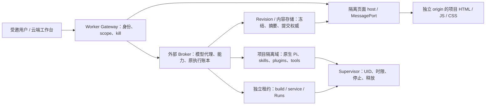

# Pi 可扩展工作台审计 — 2026-10-15

本报告对应 [#211](https://github.com/jihegao/riffology-cloud/issues/211)。目标是新 Session 默认 GPT 6 Luna，并让云端项目能加载 skill、原生 Pi 插件、动态工具和自定义页面；平台掌握权限、模型代理、保存权威与资源释放。用户已明确：本次盘点的全部 34 个现有项目及关联历史仿真内容永久删除，后续新项目不自动进入删除集合。

当前实现是固定工具的远程 Pi facade，尚不是可扩展 Pi 工作台。最需要改变的是执行域、资源发现、包构建和页面协议。模型能力提高能改善生成质量，不能代替进程隔离，也不能让插件输出成为平台权威。

## 证据与边界

- 源码基线：main fbc0e46bde2c8781b71609fa4524d2e75bffaf99；在独立 checkout 审查，未修改原用户工作区。
- 三个 Codex agent 分别检查 runtime、页面、门禁/测试，并交叉质疑方案。以下 65 个重点覆盖点来自源码和测试审查；文件 inventory 为 services 428、tests 442、scripts 181、workflow 1，不代表逐行穷尽或动态验收。
- 对照 Delivery Project、#104/#136/#148/#152/#85 及 release-readiness。Project 读取缺 read:project scope，无法核对或同步其字段；任务未被宣称 Ready/Done。既有已合并功能不重新排开发。
- 当前发布索引记录 Gateway d9ceec61-1e5f-48cc-8a51-3abdb4b06614、Entry 5869db28-cb18-4bcc-8e2a-7364e8c888ce；99/6 bindings、23 SQLite exports、5 container associations、15 container applications、8 Preview profiles。此处使用既有发布证据，本轮没有重复部署或完整线上验收。
- #104 已是 meter-only，现行 reviewAt 为 2026-12-31 23:59:59.999 Asia/Shanghai；旧 AGENTS 中 10 月 20 日不是最新状态。调用次数与费用不再是当前 Beta 准入上限，资源/时限/停止仍在。
- GPT 6 Luna 改动在 [#209](https://github.com/jihegao/riffology-cloud/issues/209) / [Draft PR #210](https://github.com/jihegao/riffology-cloud/pull/210)，已有离线专项检查，未合并、未部署、未验证线上模型访问。
- 本轮 Cloudflare 只读 settings 与 SELECT 元数据：34 项目，9 archived，25 未归档，0 deleting；关联 1 submission、1 model version，4 owner。SQL meta 均 rows_written=0、changes=0、changed_db=false。未停止资源、删除对象或调整门禁。见 [脱敏冻结清单](evidence/releases/pi-extensibility-audit-20261015.json)。
- 用户提供的 localhost:8504 页面在本环境不可达；未宣称观察了它的具体实现或完成 UI 对齐。
- OpenCode 实际尝试 opencode/claude-haiku-5-5，返回 HTTP 402 Insufficient account funds，未取得模型意见。Claude Code 原未登录，GLM 5.2 配置也未找到；用户随后取消其参与，改用现有 agent。没有把内部 agent 意见归给外部模型。

## 建议架构与工作方式

云端基础环境仍用 Worker/DO 承接入口、持久状态与调度，D1/R2 承接目录和内容。harness 指整个任务生命周期：加载上下文、派发模型/工具、处理取消、保存和恢复；Pi agent 只是其中运行模型循环与扩展的部分。Cloudflare sandbox/container 是代码执行边界，不是 skill 指令或 JS loader 本身。

要兼容任意原生 Node/TS Pi 插件，优先将整个可扩展 Pi 放进不可信项目执行域。只把插件放进一个有限 facade 可以分步交付，但不能宣称完整 Pi API、生命周期钩子、Session/provider hooks 都兼容。项目代码不能与控制凭据、权威状态在同一可修改进程中。

三个生命周期分别管理：编辑 Turn 的 source writers 静止后才能冻结 Revision；纯静态页面由浏览器生命周期管理，不占云端运行lease；build、service和远程计算才需要独立云端lease。持续service只读挂载immutable Revision，不得有源目录或源文件的可写FD，使用独立UID/容器；当前process_quiescence.py:297-334会封存整个项目UID，仅拆逻辑pool仍会一起停止。需要可变数据的应用通过项目broker保存版本化状态，页面长期打开不必让编辑容器永久存活。

## Runtime、插件和依赖：20 个覆盖点

下列路径均相对仓库；行号以审计基线为准。处理表示目标实现，不表示当前已开放。

| # | 证据与现状 | 处理与替代保障 |
|---|---|---|
| R1 | services/runtime/controlled-pi.mjs:26-53，resources 全空、extendResources 拒绝、reload 无操作 | 新项目加载 .pi/skills、AGENTS、prompts；原生 extensions 在隔离域加载，记录资源摘要。 |
| R2 | controlled-pi.mjs:243-248、302，trust never、skill commands/templates 关闭 | 移除项目能力禁令；项目指令可生效，服务端权限仍决定工具动作。 |
| R3 | controlled-pi.mjs:215-264，project_*、固定工具、noTools、任何 extension 拒绝启动 | 动态 registry/工具 schema、命名冲突与冻结版本；插件不能替换平台保存/身份 API。 |
| R4 | services/trusted-pi/product-tool-bridge.mjs:4,21-49、services/tools/protocol.ts，9 工具/8 操作 | 平台小 API 与项目工具注册分开，保留 command ID、intent digest、deadline 与终态账本。 |
| R5 | controlled-pi.mjs:170-195，checkpoint 不含 custom entries/messages | 版本化有界 inert extension state，校验图与 scope；restore 不执行代码或旧工具。 |
| R6 | controlled-pi.mjs:181-189，当前 model/tool allowlist 控制历史读取 | 对未来保留的当前 Session 分开“可读记录”和“新调用权限”；被删除 34 项目的 Session 直接 purge。 |
| R7 | controlled-pi.mjs:247,283-323，compaction/reload/model picker 等缺失 | 允许受代理计量的 compaction 与安全点资源切换；未知 provider 不自动重发。 |
| R8 | release-candidate.mjs:6-9,78-81，5.6 Luna、4096 output、单 simulation skill | 新 Session 默认6见 #210；ModelProfile 可配置输出/上下文，仿真指导成为可选 skill。 |
| R9 | trusted-pi-turn-host.mjs:38,210-222，只有 text/tool/artifact 事件 | 版本化插件 commands/status/custom UI 事件；payload 有界且不作为权威回执。 |
| R10 | trusted-pi-turn-host.mjs:14-19,79-85,162-169，16k输入、15k文本、2048事件、2MiB结果、8MiB Session | 分块/引用及累计预算，明确超限；不能简单删除所有有限上限。 |
| R11 | services/sandbox/classes.ts:94-100、policy.ts:75，项目 deny-all egress | 加锁版依赖构建/项目能力 broker；不给 ambient keys 或任意内网访问。 |
| R12 | project-tools/project_network_fence.py:3-13，连 loopback/Unix connect 都禁止 | 先隔离 root Sandbox API 并设计 broker IPC；单改 allowedHosts 无效，直接删 seccomp 有风险。 |
| R13 | project-tools/Dockerfile.cloud:1-26、effect_wrapper.py:20，Python 固定工具链/PATH | 新 Node/Pi/TS 项目 runtime profile，平台二进制不可写、项目进程 non-root。 |
| R14 | tools/protocol.ts:76-81、file_service.py:448-507，bash30s、禁 stdin、输出6000/流、杀后台后代 | 保留有限 bash；另加受监督 start/poll/stop/interactive 作业，lease/TTL/取消/实际释放。 |
| R15 | workspace_archive.py:25-29,77-103,175-199，56MiB/4096文件、禁止 links | Source Revision 保存源码与 lock；node_modules 可重建缓存分离，继续安全解包。 |
| R16 | tools/protocol.ts:43-49、file_service.py:49-60，只禁 .riffology | .pi/.agents/AGENTS 已允许写，bash 并非命令白名单；实际缺的是加载、运行与保存依赖。 |
| R17 | product-tool-bridge.mjs:48，依内容 marker 限制 model/run.py 写入 | 通用文件写入不认 marker 权威；打包时按 adapter 摘要/profile验证。 |
| R18 | release-candidate.mjs:12-17,55-57,81，五文件与 stdlib/Mesa 指导全局注入 | 拆可选仿真 skill 与真实执行 profile，prompt 如实描述已开放能力。 |
| R19 | sandbox/policy.ts:55-73、project-sandbox.ts:12-36，签名与 server-derived actor | 保留在项目代码之外；扩展不能选择身份、密钥或跨项目 scope。 |
| R20 | classes.ts:147-182、runtime_supervisor.py，dispatch fence/UID/stop/quiescence | 保留并泛化；原 supervisor 与 broker 决定执行/释放，writer静止后提交。 |

必须先解决的权威缺口：Dockerfile.trusted-pi.cloud:6-9 的程序由 root 管理，但 /var/lib/riffology/pi 与 /turns 为 Pi UID 可写；services/turn-runtime/pi-native.ts:123-137 读取合法 shape 的 saved.outcome。当前固定受信 Pi 适用的信任，不能沿用到任意扩展：插件可以修改同进程和这些输出。开放后，saved.outcome 只能是项目报告；agent声明和exit=0都不证明动作成功。原生writers实际停止且canonical snapshot合法后，可以保存标为failed/interrupted的用户产物；保存收据由RevisionStore commit确认，动作终态与资源释放分别由外部broker原账本和原supervisor/fence确认，不能用agent输出返还容量。

## 页面、可视化与包：20 个覆盖点

| # | 证据与现状 | 处理与替代保障 |
|---|---|---|
| V1 | browser-preview/contract.ts:13-20、validator.ts:58-61，必须五模型文件与 ModelSpec | 通用 project.views/v1 只需入口和安全资产闭包；仿真五文件为可选 profile。 |
| V2 | validator.ts:18-26，单 render(context)、import/DOM/storage等 token 黑名单 | 通用页允许正常 DOM/ES modules/CSS；隔离 origin 与 broker 控权，regex 不是通用隔离。 |
| V3 | validator.ts:29-47，固定 Python imports/run(config)/顶层限制 | 移入 simulation-pyodide 兼容 profile，不阻塞通用页面/服务。 |
| V4 | contract.ts:6-12、validator.ts:73-76，页面也必须 exact run.py hash | 页面展示与服务端计算声明分开；Verified 路径继续验证冻结计算源。 |
| V5 | profiles.ts:5,15,24-25，stdlib/Mesa 两种精确依赖 | 构建 lockfile 与摘要闭包，通用 npm/库在独立构建域解析。 |
| V6 | contract.ts:24,62-65、js-scene.mjs:12-14，固定入口600×420 | manifest 安全入口、响应式尺寸与 resize；不再限制601像素。 |
| V7 | js-scene.mjs:22-45，rect/circle/line/text 与2048 marks | 用 iframe 内普通 DOM/CSS/canvas/图表库，不继续扩平台手写 UI DSL。 |
| V8 | js-scene.mjs:16-20、js-frame.mjs:23-35，只 pointer/select、2048 lifetime | DOM事件留 frame；过 broker 的消息有类型/速率/字节背压。 |
| V9 | browser-preview/runtime/host.mjs:28-53,69-79，先 Python trace 才挂 JS | 纯页面直接挂载；计算为独立可选 worker/service 能力。 |
| V10 | browser-preview/runtime/protocol.mjs:30-50、validator.ts:13-16，grid/lane/metrics通用化 | 领域数据合同归仿真插件，通用页读取声明的数据/artifacts。 |
| V11 | profiles/protocol/validator，500 steps、501 frames、10k agents、1M cells、JS128KiB | 领域限额归 profile；包/消息/执行时间有统一资源预算，支持bundle库。 |
| V12 | browser-preview/runtime/host.mjs:8,15-17,68,90-93，canvas120s到期/paint10s | 删除一般页面两分钟寿命；保留每次计算 watchdog、取消与清理。 |
| V13 | browser-preview/runtime/host.mjs:9-13,37,60-72，独立HTTPS site、allow-scripts 无同源 | 保留；主站DOM/cookie/localStorage/service worker不可给项目页。 |
| V14 | execution/index.ts:15-23，固定frame/hash脚本、connect-src none | 新不可变模块/CSS/media资产交付与相应 CSP；不把任意项目文件放 app ASSETS。 |
| V15 | js-frame.mjs:1-2,12,20,37-57，无项目API/updates broker | MessagePort绑定具体iframe与project/view/package/generation，只开放typed读取/订阅；host/server定scope并在await后复核，切换/撤权销毁旧port。 |
| V16 | simulation/model-artifacts.ts:3-32，24view、6renderer、禁HTML/嵌套/代码 | 新 project.views registry 注册页面与 placement，不要求每类可视化修改平台enum。 |
| V17 | web/layout.js:20,29、app.js:49-58，固定 preview/model/runs/inspect | 合并平台面板与校验后项目页面 descriptor，持久 scope/view/package 路由。 |
| V18 | web/artifact-views.js:5-36，已有focus/selection/保留节点 | 复用导航；用户内容仍装在平台创建的 iframe，不能 innerHTML 入主站。 |
| V19 | validator.ts:49-53、packager.ts:12-29、build-host.ts:65-73，scope/digest/持久refs | 保留不可变内容身份、安全路径、写引用后回执；控制数据不成为页面asset。 |
| V20 | build-host.ts:19,38-58,113-125、preview/declaration.ts，历史rearm与旧Python8080 Service | 不复用旧package身份解释成可执行app；新服务有明确 profile/lease，不打开旧实验gates。 |

页面第一批交付：多页HTML/模块/CSS、表单/图表、响应式、当前项目files/artifacts/updates订阅与刷新恢复。broker不提供任意app API fetch，不传凭据，不接受页面自报scope；离开、切换或撤权终止旧订阅。工具写动作和长驻服务单独验收；页面显示成功不等于获准付费运行。browser输出仍local/unverified。

## 门禁、容量与发布：25 个覆盖点

| # | 证据与现状 | 处理与必须保留 |
|---|---|---|
| G1 | gateway/turn-runtime-gate.ts:11-23、turn-services.ts:65-67、workspace/durable.ts:1428，三层M2开关 | 单能力配置；前端友好预检和服务端/await后权威校验保留。 |
| G2 | gateway/turn-services.ts:43，G5存在参与当前提交路由 | 新项目按持久 runtime kind 路由；旧未知scope仍查原fence。 |
| G3 | gateway/index.ts:142-155，developer/Managed/invited/G5/G4创建分支 | 常规邀请项目单一路由，验收例外移私有maintenance入口。 |
| G4 | catalog/project-admission.ts:36-47，invite/user/authVersion/personal owner | 保留；插件功能无需公开注册，也不能授予membership。 |
| G5 | model-proxy/release.ts:24-30，M2/production/budget/G5/profile/evidence复合开关 | ModelProfile+kill；历史G5不作新路由构造前提，秘密/归属验证保留。 |
| G6 | release-candidate.mjs:6-9,75-79，模型与115s重复 | ModelProfile/ResourcePolicy贯通，避免多处不一致；#210独立。 |
| G7 | private-beta-policy.ts:11,44，reviewAt与8/6min/15min上限 | 运营期限不作插件安全理由；有限资源策略可配置，当前授权不默改。 |
| G8 | private-beta-capacity.ts:36,116-117，每user一个active跨项目 | 公平队列/per-user资源；一个workspace写互斥保留，实际容量先验证。 |
| G9 | capacity/durable.ts:23-26，limit字面1与singletonFIFO | 改N资源池须连scheduler实现一起改，ACK-loss/no duplicate grant保留。 |
| G10 | infra/wrangler.phase1-staging.jsonc:178-209，五container各1 | scheduler与实际部署容量一致；删应用quota不能增加真实资源。 |
| G11 | turn-runtime/core.ts:127,233、pi-native.ts:80,87，10min硬编码与Beta15min | deadline批准后持久到全部链，过期不能启动与native stop保留。 |
| G12 | tools/protocol.ts:78,87、release-candidate.mjs:76，30s/120s/115s/6min | policy统一；install/build/service异步job，不拉长单HTTP到无限。 |
| G13 | turn/protocol.ts:75-77、product-model-transport.mjs:14,18,36，16k/1MB/字节估算 | 输入引用/分页/streaming，保守估计算法版本化；不盲删Worker内存限制。 |
| G14 | controlled-pi.mjs:243-250，thinking/compaction/retry关、工具串行 | thinking/compaction可配置；未知provider不重发，写工具保留顺序/并发合同。 |
| G15 | private-beta-capacity.ts:145、pi-developer-durable.ts:45、model-proxy/http.ts:218，已meter-only | 不再把“取消费用/次数quota”列新开发；计量与未清reservation保留。 |
| G16 | private-beta-capacity.ts:52-63,170-229，digest pin含大量运营参数 | 原actor内明确profile/policy迁移；不能新actor重置历史。 |
| G17 | private-beta-policy.ts:77-85、pi-developer-durable.ts:81-96，每次核对Legacy/G5 | 历史未知fence提取可信ExecutionRegistry；内容purge不清隔离/费用事实。 |
| G18 | private-beta-capacity.ts:235-241，任一Pi未知全局阻挡Runs | 建原资源归属再缩窄至相关pool；当前共享资源不能先去全局fence。 |
| G19 | simulation/invited-policy.ts:4,12，Runs1/user1、group4..8/10min/guard6min | 按作业资源参数化；冻结输入/seed、终态和release保留。 |
| G20 | invited-resource-quiet.ts:16,24-35，要求M3/M4/G5关、全owner扫描 | 用原执行/lease目录替代阶段互斥；新namespace不证明独立。 |
| G21 | workspace/durable.ts:890,914,968,1006，G5一票禁Service、Observer耦合M2/M3 | 独立project-service/订阅能力；ACL、stop、原资源隔离保留。 |
| G22 | gateway/preview-services.ts:38、workspace/durable.ts:849,939,959，M3Preview开关 | 能力视图反映pause/实际资源原因；GET不分配runtime、CSRF保留。 |
| G23 | browser-preview/g4-build-hold.ts:8,18，120s operator故障注入进常规alarm | 无残留hold后移到测试adapter，保留真实R2/cold恢复用例。 |
| G24 | scripts/m3/vertical-staging-preflight.mjs:90-114，旧gates/quotas/两service/迁移形状 | 退出通用发布门禁，采用实际deployment manifest/hash/binding漂移检查。 |
| G25 | .github/workflows/check.yml:3-7,35-51、package.json，阶段全套/重复UI检查 | 组件CI+受影响集成，主干/定期全套；历史零引用代码与测试删除。 |

Provider自动retry与provider fallback继续关闭，包括已知失败。可有界自动重试的是已证只读查询和不会重新派发的原收据传输；已确认权威终态的项目命令先检查部分写入，再创建新的调试意图。未知模型/写操作/外部副作用只核对原身份与停止释放。ProductTurnRuntimeCore.observe（core.ts:251-254）可能启动、checkpoint、取消或fence，不是纯metadata查询，不能当只读排查接口。

## 测试应怎样删除和改写

| 类型 | 具体位置 / 行为 | 最终处理 |
|---|---|---|
| 插件全部禁止 | tests/m0/pi/controlled-pi.test.mjs、resource-loading-probe.test.mjs | 固定可信host仍在时保留负例；新项目域加加载skill/plugin、热加载与越权拒绝正/反例，host退役再删除对应旧测试。 |
| 当前allowlist决定历史可读 | controlled-pi.test.mjs:148-182 | 当前新Session恢复应不依赖插件仍安装；旧34项目历史内容直接删除，禁止恢复。保留scope/图结构/no replay。 |
| 固定九工具/一个skill/prompt文字 | tests/m2/product-tool-bridge.test.mjs:11-13、trusted-pi-release-candidate.test.mjs:10-25 | 改registry注册、必要平台API、冲突/schema/摘要与真实加载行为，不为green保留旧限制。 |
| marker/源码regex | product-tool-bridge.test.mjs:23-31、trusted-pi-turn-host.test.mjs:121 | 用包摘要/权威边界执行测试替代；新版合法fs/import不应因字符串检测失败。 |
| 五文件/600×420/marks/禁DOM | tests/m3/browser-preview-*、scene/protocol测试 | generic页面改HTML/modules/CSS/表单/resize成功测试；仍支持仿真的领域合同归可选profile。 |
| 历史六profile/adapter固化 | browser-preview-legacy.test.mjs、canvas.test.mjs:49-81、execution/execution.test.ts:18、orchestrator.test.mjs:28-47 | 目标内容及范围外引用清零后连代码/资产/fixture一起删除，不永久迁到compat目录。 |
| 单容器/旧阶段gates | trusted-pi-capacity、invited-run-capacity、gateway-turn-runtime-gate、vertical-staging-preflight测试 | 改N容量、公平性、实际pool isolation/能力合同，不把1或M3必false当不变量。 |
| finite bash与writer静止 | project-files、project-supervisor、workspace-archive、trusted-pi-native | 保留；长驻服务独立 start/observe/stop/TTL/release测试。不能删quiescence让daemon假成功。 |
| unit与Workerd同名断言 | quota-workerd、warm-runtime-workerd、private-beta-quota-migration | unit做矩阵，Workerd保留跨重启/绑定/原子性边界；fixture不能证明真实container release。 |
| 重复UI与重型默认CI | check:ui/test:m1四个i18n文件、Chrome/prepare-assets、#73/spikes | 去重；按组件路径选浏览器/Worker集成并缓存摘要校验，主干/定期完整；无测量前不估算分钟/费用。 |

不可删除的行为保障：真实第二身份与跨tenant/project权限、CSRF/撤权、secret与内网隔离、旧generation拒绝、原请求at-most-once、ACK丢失不重复、未知占用不返还、后代进程实际停止、原子Revision与安全解包、不可变内容摘要、browser结果不冒充Verified。CI测试、部署200、fixture或单账号局部成功不能替代真实双身份/资源释放验收。

## 全部34项目永久删除

用户授权已经明确，不再保留这批历史仿真内容，也不为它们默认做备份/博物馆式兼容。冻结清单的身份摘要为 e418ac2d10eba71eda7a7cb276e5cd325359dd26027fb5adaa0609049a010640。原始身份元数据仅用于执行清单；仓库证据保存hash和计数，不含标题、源码、prompt、参数值或结果。

当前只有 ProjectArchives archive/restore；schema预留 deleting 不等于实现purge。阻碍包括：

1. catalog/migrations/0012_project_archives.sql:9-28、0009_model_submissions.sql 与模型相关 immutable/no-delete triggers/FKs，不能直接删project或全局关约束。
2. turn-runtime/revision-gc.ts:3-6、revision-store.ts:129-150 保留所有manifest，普通GC不能删除全部Revision/Session。
3. 用户内容散布在D1、Workspace/Runtime/Tool/Simulation DO、R2、容器、发布导出和适用Managed远端Session。tool command_json/result_json/stdout、Run指标、对话不能笼统当账本保留。
4. publication-v1/content|export/<sha>、model-content全局共享，关联submission/modelVersion也按固定ID集合处理。冻结后阻止目标modelVersion的新复制/引用；删除前重查引用并CAS。范围外新项目不自动加入purge；若有存活引用，必须说明阻碍并解决该引用，不能递归扩大项目删除范围或默默留下后宣称彻底删除。
5. 清空actor后旧alarm/outbox/callback可重建旧scope，缺项目级永久fence；原project.create intent/key删后，旧请求可能分配新随机projectId（catalog/projects.ts:87-100）。需保留无内容request-key/idempotency digest→gone以及modelVersion/source tombstone，create/copy和异步写入前后检查。outbox_busy=0不证明执行已停止或容器释放。

[#212](https://github.com/jihegao/riffology-cloud/issues/212) 的最小执行顺序：冻结原34scope及关联内容闭包 → 写不可复活fence并撤销访问/停止producer → 核对原执行释放 → 迁出不含用户内容的必要用量/费用/终态/隔离事实 → 原operation分批删除D1/DO/R2/容器与适用remoteSession → 权威计数/key absence与旧回调/重启防复活验收。

删除ACK丢失查同一key/operation，不restore/rebuild。未知执行隔离和费用reservation不会因内容清理消失；如实际容器已销毁、写fence生效而费用待核对，可保留无内容摘要独立处理。备份/time-travel的实际保留与删除能力需按提供方核对，不能承诺立即抹除所有底层备份；已被用户下载的外部副本不能由服务器撤回。

当前发布保留8 Preview profiles，其中6为旧727c40f/pre-142/pre-150，2为新构建stdlib/Mesa。清理后删除 services/browser-preview/execution/retained 下6个旧profile与专用bytes、materialize.mjs:33-48 retain复制逻辑、build-host reviewedRetained读者、旧adapter fa798709… 与仅为其存在的测试。当前adapter b0c785d8…、2个新构建profile和共用Pyodide资产不能仅按legacy/v1名字盲删；先按hash集合和剩余当前调用核对。若通用工作台保留仿真为可选skill，当前仿真renderer归该profile；若不再有调用，再删除代码本身。

目前完成的是授权范围冻结和删除设计，不是数据清理。DO/R2完整数量、实际release、共享引用、远端副本与备份还未核验。

## 拆分到现有交付系统

Issue管理范围和完成条件；下表仅说明技术依赖，不另建状态路线图，不表示所有任务同时开工。新增项均保持Backlog建议，负责人 @jihegao，Project字段未同步；当前#104与已部署验收执行位不扩大。

| 任务 | 交付与依赖 |
|---|---|
| [#209 / PR210](https://github.com/jihegao/riffology-cloud/pull/210) | GPT6默认及原actor profile迁移；线上模型访问/部署/验收待完成，不被本报告当已上线。 |
| [#212](https://github.com/jihegao/riffology-cloud/issues/212)，父#148 | 全部34项目及关联内容purge、防复活、release与零引用核验；不再以恢复旧项目验收为目标。 |
| [#85](https://github.com/jihegao/riffology-cloud/issues/85) | 项目AGENTS/skills/prompts读取、命令、provenance与冷恢复；官方simulation-skills是可选内容，不是通用项目资格。任意原生扩展由#213承接。 |
| [#213](https://github.com/jihegao/riffology-cloud/issues/213) | 整个可扩展Pi进入项目隔离域；dynamic tools/custom state/events/reload，平台authority置外。 |
| [#214](https://github.com/jihegao/riffology-cloud/issues/214) | project.views/v1、多页模块DOM与只读updates broker；写动作和长驻服务独立切片。 |
| [#215](https://github.com/jihegao/riffology-cloud/issues/215) | 能力/资源策略、原lease目录、build/service作业；先有归属证据，再拆全局门禁与扩容。 |
| [#216](https://github.com/jihegao/riffology-cloud/issues/216) | 跟随新合同改测试与CI；历史引用零后删除兼容实现/测试；安全行为覆盖不减。 |

优先做可验证的小切片：purge基础能力与冻结清单核验；项目技能加载；无需模型调用的通用静态页面。随后交付隔离Pi和broker动作/服务。资源N与全局fence收窄须等原资源目录与release证据，不以“模型更强”替代这些依赖。这里只确定拆分，并未启动多项产品开发。

## 本轮验证

只运行文档/证据结构、链接/源码anchor存在性和git diff --check；不为审计重跑付费模型、云端实验或全套CI。外部Haiku请求失败事实与内部agent评审分开记录。所有建议仍须在对应Issue的实现PR内验证，部署与真实用户验收另回填发布索引。
