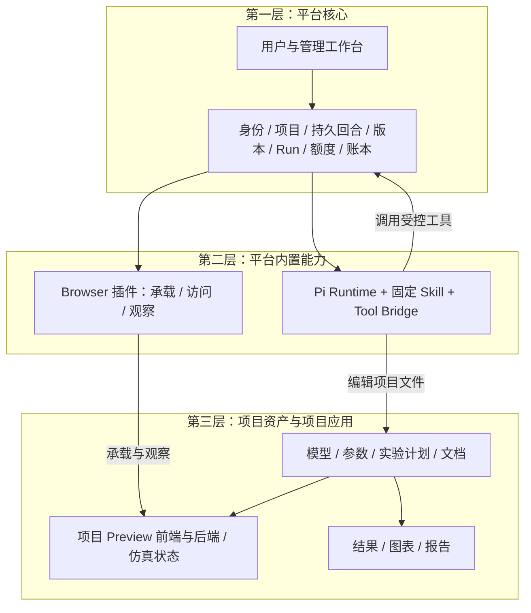

# 平台功能与项目内 Pi Agent 构建边界

日期：2026-09-05  
状态：开发职责与交互契约；实现进度见[开发执行状态](development-status.md)，本文不作为功能验收记录  
关联：[MVP 系统概要设计](mvp-system-design.md)、[UI 设计](ui-design.md)、[官方模型库、多租户与 Token 付费](model-library-tenancy-billing-design.md)、[开发与部署计划](development-deployment-plan.md)

## 1. 基本结论

平台提供一个能够可靠执行、保存和管理项目的工作台。平台托管的 Pi Agent 在用户授权的项目中编写模型、交互应用和实验内容；它调用平台工具完成保存、运行和观察。**调用一项平台能力，不意味着 Agent 构建或拥有这项平台能力。**

Pi Runtime、固定 Simulation Skill、Tool Bridge 和 Browser 插件均随平台版本发布。某个项目的 Agent 可以修改该项目的 Python 模型与 Preview 应用，不能通过项目文件修改平台登录、租户权限、计费账本、运行调度、插件注册或工具实现。

本设计是独立新产品的实现边界，不包含旧系统接口兼容、数据迁移、部署复用或历史功能补齐要求。文中的路径、字段及接口是拟定契约，不表示已有对应服务。

### 1.1 写入设计与开发任务的固定提示

> 必须区分清楚：哪些是项目内 Pi Agent 构建的内容，哪些是平台产品功能。平台负责身份、权限、持久回合、文件版本、运行管理、Browser 插件、官方目录和计费；平台托管的 Pi Agent 通过受控工具构建当前项目的模型、交互应用、实验与报告。调用平台工具不改变能力归属，项目内容不能成为平台权限或执行结果的权威依据。

每个功能任务、页面设计和 PR 都回答以下三项，并将答案放入其交付说明：

1. **谁发布、谁能修改？** 随平台版本发布的是平台代码；保存在项目 Revision 中、可由用户或 Pi 修改的是项目资产。官方模板复制后属于独立项目，来源仍须保留。
2. **谁确认状态？** 身份、已保存、Run 完成、停止确认和费用由平台确认；仿真时钟、领域参数和业务指标由项目应用提供。项目返回的数据仍须经过平台契约校验。
3. **替换项目时是否还成立？** 更换机场模型后，平台导航、Runs 和 Browser 外壳应保持通用；机场参数、画面和图表随项目应用替换。

例如，“探索资源配置”表单与保障组滑块属于项目应用；承载它的 Browser、启动服务和限制运行额度属于平台；“20 次实验已完成”必须来自平台确认的样本收据。

开发期间由主控 Agent 或 subagent 编写平台源码，是平台工程活动。它与产品运行时的“项目内 Pi Agent”是不同角色，不能据此给项目 Pi 授予仓库、部署或管理端权限。

## 2. 三层职责

第一、二层都属于平台产品代码，区分两层是为了明确内置扩展的责任。第三层属于 Tenant 下的项目资产，可以来自官方模板、用户上传或 Agent 创建，不能统一称为“Agent 原创”。

| 能力或资产 | 所属层与实现责任 | 项目内 Agent 的权限 |
|---|---|---|
| 登录、邀请、Tenant、Membership、项目授权 | 平台核心 | 使用已授权项目上下文，不能授予权限 |
| 项目列表、创建、重命名、删除 | 平台核心 | 通过明确开放的工具申请操作，不能直接改目录数据库 |
| Session UI、消息输入、工具卡与回合状态 | 平台核心 | 产生回复和工具调用事件，不能替换工作台实现 |
| 持久 Turn、事件回放、取消、故障对账 | 平台核心 | 接收执行与取消信号，不能自报权威终态 |
| Workspace、Revision、Checkpoint、文件持久化 | 平台核心；RevisionStore 独占 R2 对象读写，WorkspaceAgent 提交产品收据与 head | 修改项目文件并请求保存；保存收据由平台确认 |
| Files / Changes Panel | 平台核心 | 提供被展示的文件变化，不能伪造权威 Diff 或版本 |
| Run 登记、调度、进度、日志、停止与 Artifact | 平台核心 | 提交计划、读取记录；不能绕过额度或自行结算运行 |
| 模型代理、供应商凭据、预算、Token 账本 | 平台核心 | 发起已授权模型调用，不能读取凭据或改余额 |
| 管理端、运营审计与官方版本发布 | 平台核心 | 普通项目 Agent 不具有平台发布或管理权限 |
| Pi Runtime、上下文恢复、工具装配 | 平台内置能力 | 执行当前项目任务；运行时本身由平台安装与升级 |
| 固定 Simulation Skill 与 `simctl` 契约 / 受控入口 | 平台内置能力 | 遵循接口编写项目实现，不能替换平台执行包装器 |
| Browser Panel、访问代理、Observer、Browser 工具 | 平台内置能力 | 调用已启用工具；不能修改授权或注册任意插件 |
| 仿真实体、资源、规则、假设、参数与指标 | 项目资产 | 依据需求创建、校验与修改 |
| Preview 页面、参数表单、业务图表与应用后端 | 项目资产 | 在 `app/` 内构建；通过平台登记服务 |
| 实验参数组合、种子清单、结果解释 | 项目资产 | 在 `experiments/` 与 `docs/` 内编写和修改 |
| 仿真状态与领域操作 | 项目应用 | 应用后端推进状态；Agent 可修改其实现并重新发布版本 |
| 官方发布包 | 平台管理的共享只读资产 | 可经复制取得独立项目内容，不能改写源版本 |
| 复制后的源码及用户修改 | Tenant 的独立项目资产 | 在项目授权内编辑，来源记录保留 |

## 3. 可编辑内容与受保护控制面

| 位置或对象 | 可编辑内容与约束 |
|---|---|
| `/workspace/model/` | 模型代码、领域规则和参数定义 |
| `/workspace/app/` | 项目应用前端、应用后端、状态查询和领域操作接口 |
| `/workspace/experiments/` | 参数矩阵、唯一子任务与种子清单、结果 schema |
| `/workspace/docs/` | 模型假设、使用说明、校准记录与分析报告 |
| `/workspace/app/preview.json` | 项目维护的 Preview 声明；平台从已保存 Revision 读取并验证，不授予能力 |
| `/workspace/.riffology/` | 平台保留的控制目录；项目工具及公共归档拒绝读写该命名空间 |
| `/workspace/results/` | 平台发布的已保存结果索引及可读副本；用户自写分析文件可以另存，不能覆盖权威 Artifact 收据 |
| Run 工作副本与临时输出 | 平台为具体 Run 提供的受限路径；输入版本只读，输出必须验证并由平台发布 |
| Pi 恢复包、工具实现、内置 Skill、插件清单 | 平台受保护目录和构建产物，不交给项目命令修改 |
| WorkspaceAgent / TenantBilling 数据、D1、R2 控制索引 | 通过受鉴权服务访问，项目不持有数据库或对象存储写凭据 |
| 供应商密钥、访问会话、进程租约、计费及审计记录 | 平台控制面；不得进入项目文件、环境、快照或普通日志 |

Agent 的普通文件编辑权不扩展为宿主权限。平台同时校验规范化路径、符号链接目标、进程身份、挂载与网络边界；项目 `bash` 不能借可写目录替换平台命令。声明文件写入成功也不代表平台接受了声明或授予了能力。

Pi 使用自定义、受控的 ResourceLoader，禁用从项目 `.pi/extensions` 等目录自动发现可执行扩展；`.pi/skills`、`.agents/skills`、祖先目录指令及 agentDir 的模型、设置和凭据来源按显式加载策略处理。用户文件可作为建模内容，不因此成为平台工具或可信配置。每次 Session 恢复都重新校验当前模型与插件白名单，不直接信任恢复包中的旧工具引用。具体 SDK 参数在版本锁定的技术验证阶段确认，依据 [Pi SDK 文档](https://github.com/earendil-works/pi/blob/main/packages/coding-agent/docs/sdk.md)。

当前实现方向采用[ADR 0001](adr/0001-pi-project-trust-boundary.md)：可信 Pi / 控制执行器与项目代码分处不同执行信任域，经鉴权工具桥通信；云端隔离验收尚未完成。可信宿主不挂载项目目录，项目命令不能读写权威 Pi 恢复包、读取平台凭据或扩大控制权限。

M0 仍须在实际环境验证文件、进程环境、信号、IPC、控制 RPC 与网络边界。项目可能控制自己执行域内的 SDK 接口，其响应仍是待校验项目数据；平台必须拒绝借此跨项目访问、伪造收据或修改配额。只把文件放在 `/workspace` 外或在提示词里禁止访问不构成隔离证据。未通过云端门禁时继续本地验证，不进入 M1 的真实执行接入。

## 4. 官方资产复制到独立项目

`平台发布不可变版本 → 用户选择固定版本 → 平台验证许可与来源 → 复制文件 → 初始 Revision → 用户 / Pi 在独立项目中修改`

官方目录、版本状态、许可、内容摘要和发布检查由平台管理。初始化同时记录 `source_model_id`、`source_model_version`、`source_digest`，权威来源保存在项目元数据中；项目里的可读来源说明不能反向覆盖该记录。

复制本身不要求 LLM，也不意味着 Agent 重新生成全部代码。Agent 的后续修改形成新的项目 Revision，不回写官方库、不影响其他副本。官方新版本通过另建项目使用，不自动覆盖用户工作；撤回只阻止新复制，既有项目按已授予许可保留。

UI 使用“复制此版本创建项目”和“来源：机场保障 1.0.0 · 独立副本”。空白项目与上传内容分别显示来源；每回合摘要只报告本回合真实修改。发布官方模型是管理端独立流程，不能通过项目内一句“发布为官方”绕过发布权限和检查。

## 5. 项目与平台之间的最小契约

以下接口名称和字段供实现阶段冻结 schema；当前不新增可执行接口。平台只接收明确、版本化的项目声明，不从业务字段隐式推导平台权限。

### 5.1 项目声明

Preview 声明在 M3 实现中冻结为 `app/preview.json`，由项目维护、平台从已保存 Revision 验证。字段为 `schemaVersion: 1`、`runtime: "python"`、`entrypoint`、`dependencyLock`、`port: 8080`、`healthPath`，以及可选 `observation.pagePath/statePath`。声明不能包含命令、环境变量、平台凭据或外部地址。`.riffology` 保留给平台控制数据，不再作为项目可写声明路径。

这只冻结 Preview 的数据契约；通用 Run 的参数、结果 schema 和运行类型仍需在执行阶段单独定义。解析成功不代表依赖已安装、服务已启动或观察接口只读。实施顺序及验收边界见 [M3 执行计划](m3-execution-plan.md)。

| 责任 | 项目提供 | 平台处理 |
|---|---|---|
| 执行入口 | 相对路径、入口参数与运行类型 | 校验路径、类型和策略，用受控执行器启动 |
| 参数和结果 | 字段、单位、范围、结构及说明 | 做结构校验；不因此承诺领域模型正确 |
| Preview | 项目应用入口、允许的服务端口声明、健康路径 | 分配和登记实例，验证端口策略与就绪状态，签发访问授权 |
| 依赖 | 锁文件及项目所需依赖 | 按固定镜像与安装策略构建，拒绝越权安装 |
| 平台归属 | 不由声明提供权威身份 | Tenant、Workspace、Revision、额度、租约均由服务端注入 |

清单不接受自选 Tenant、平台密钥、任意外部代理目标、管理员权限或插件加载代码。项目路径、端口或 schema 更改必须经过检查和新 Revision，不能影响已运行的旧版本实例。

### 5.2 显式实验计划

拟定路径为 `experiments/<plan>.json`。项目计划包括 `schema_version`、模型入口、参数组合、重复规则、每个子任务的 `task_id` 与种子、所需输出及成功条件。机场“4 组与 6 组”的业务含义由项目定义。

平台在接收时固化计划摘要和输入 Revision，补充 `run_id`、Tenant、Workspace、发起者、资源上限、运行镜像和幂等请求键。平台检查计划规模与种子清单，然后调度独立工作副本；不会在 Runs Panel 中固定“保障组数”或机场指标。

项目执行器输出子任务结果及候选进度。平台校验输出 schema、唯一任务标识和文件摘要，在结果持久化后更新 `planned / completed / failed / cancelled`。项目打印“全部成功”或 UI 计时器走完不能成为完成依据。

结果图表和业务结论可由项目应用或 Agent 生成；平台提供通用结果列表、文件预览、导出与来源信息。重新运行创建新的 Run，保留原计划、失败情况和已保存结果。

### 5.3 项目仿真状态与平台观察投影

项目应用后端拥有 `simulation_state_id`、`state_sequence`、仿真时钟、实体状态和领域操作。机场“暂停仿真、设置保障组数、重置场景”由该后端执行；用户页面与 Observer 读取同一服务实例的已提交状态。

项目可提供版本化状态查询接口，返回状态标识、序号、生成时间、运行 / 暂停状态、参数和指标摘要。字段是项目提供的领域信息；平台进行格式和实例关联校验，不能据此替项目证明数值正确。

Browser 插件后端负责 `PreviewInstance` 生命周期、service Run 关联、健康检查、访问和观察，不持有或推进仿真状态。观察收据由平台附加 `preview_id`、`revision_id`、`runtime_generation`、观察时间、读取状态标识与序号。

替换或重建 Preview 后，平台使旧观察失效；新项目应用实例产生新的状态标识。首版不承诺恢复任意 Python 内存中的仿真时刻；若项目支持显式状态导出，后续也须通过受验证的文件恢复契约实现。

普通网页未提供共享状态时，Observer 只能报告同一 Preview 的独立观察结果。用户本地未提交表单、滚动位置和客户端私有状态不会自动同步，也不作为“Agent 看到了用户屏幕”的证据。

**观察权限与领域副作用分别定义。** 平台向 Observer 签发绑定当前 Preview 的观察授权，不携带用户写凭据、管理权限或计费权限；允许路径、方法、WebSocket 通道与导航目的地由插件策略限制。仅使用 GET 或不开点击工具，仍不能证明任意项目页面不会在加载时执行领域写操作。

固定 Starter 的观察契约包含独立观察视图、读取状态接口和只读状态流；领域修改接口必须拒绝观察身份，观察视图不能在加载时重置场景或启动实验。验收用已暂停且无其他写入者的模型比较观察前后的状态标识、序号与领域内容，再尝试写接口和写消息并检查拒绝。运行中的仿真允许自行推进，不能把正常时间变化误判为观察副作用。

未实现或未通过该契约的一般项目，只展示“独立页面观察，领域副作用未验证”。项目源码修改使原验证失效；平台不会据此宣称任意项目代码获得了不可绕过的领域只读保证。平台权限边界始终独立执行。

## 6. UI 边界与操作语义

工作台、Files / Changes / Runs、全局导航和管理端保持统一平台视觉。Browser 外壳显示版本、服务状态、刷新与观察；嵌入内容保留明确容器边界与项目应用标题，机场控件不进入平台导航。

在设计评审中可以标注“平台插件 / 项目应用”；正式产品以“项目预览”及可展开的来源、版本和文件入口说明可修改范围，不要求普通用户理解平台内部服务名称。项目卡片展示归属和来源，不能因项目里存在应用就将整个平台工作台归为 Agent 产物。

| 操作 | 所属对象 | 状态变化与影响 |
|---|---|---|
| 暂停 / 继续仿真 | 项目应用的仿真状态 | 仿真时钟停止 / 继续；Preview 服务仍然可访问，service Run 仍为 running |
| 重置仿真 | 项目应用的仿真状态 | 按项目规则创建新场景状态或递增序号；不重建平台 Workspace |
| 刷新预览页面 | Browser 页面视图 | 重新请求页面；不会隐含重置后端仿真 |
| 停止 / 重启预览服务 | Browser 实例和 service Run | 等待进程停止确认；重启形成新的实例身份，旧观察失效 |
| 收起 Browser Panel | 当前用户布局 | 不停止仿真、服务或 Agent 回合 |
| 禁用 Browser 插件 | Workspace 插件绑定 | 停止实例并撤销访问和工具能力；保留项目文件及已有实验结果 |
| 停止实验 | 指定 Experiment Run | 停止未完成子任务，保留已保存结果；不取消其他 Run 或 Agent 回合 |
| 取消 Agent 回合 | 指定 Turn | 取消模型 / 短命工具并保存已完成修改；独立服务与 Run 另行管理 |

状态不得共用一个 `paused` 标记。至少分别投影 `simulation_status`、`service_run_status`、`observation_status`、`plugin_status` 和 Panel 可见性。项目仿真状态可以已暂停而服务健康，观察可以失败而模型继续运行。

## 7. 当前原型已确认的问题与下一步要求

本节是对本地原型的检查结论，不表示问题已修复。当前示例数据不提供真实服务隔离、执行或保存保证。

| 已确认问题 | 下一步修改要求 | 验收方式 |
|---|---|---|
| `ui/workspace.js` 把机场 SVG、参数、指标和 Browser 外壳放在同一渲染实现中 | 将机场示例归到独立项目应用示例模块；平台只保留容器和通用状态，生产使用独立源服务 | 换用另一模型时无需改平台外壳代码；不出现机场专属参数 |
| 仿真暂停与 Runs 中 Preview 暂停共用 `w.paused` | 分开领域状态、服务状态及操作名称 | 暂停仿真后服务仍健康；停止服务后访问结束且观察失效 |
| Runs 的新实验固定为“4 / 6 组，共 20 次” | 参数说明来自项目计划；Runs 仅确认和管理通用计划 | 两个不同计划展示各自参数、真实任务数及结果 |
| Browser 内“探索资源配置”易被理解为平台标准控件 | 将表单、图表和仿真控制完整放进项目预览边界 | 用户可从内容说明定位 `app/`，平台操作不混入领域工具条 |
| 模型复制按钮与项目来源未充分强调独立副本 | 明确固定版本复制及来源；Agent 修改摘要与模板初始化分开 | 复制不触发 AI 调用；修改副本不改变源版本或其他项目 |
| 观察示例使用固定标识，不能代表真实共享状态 | 从项目后端读取状态并绑定平台实例和 Revision | 两个客户端读取同一提交状态；替换实例后拒绝旧观察 |

以上 UI 调整进入开发计划，必须在连接真实服务前完成交互验收。是否完成以实现与验证记录为准，不因本文列出要求而视为已修复。

## 8. 实现评审的退出条件

1. 每个模块都有平台或项目归属，平台 API 不依赖机场领域字段；Pi 通过受控工具调用平台能力。
2. 项目命令不能改写控制目录、发布插件、获取平台凭据或调整 Tenant 余额；项目扩展不会被自动装载，Session 恢复不会绕过当前白名单。越界请求在服务端与执行边界被拒绝。
3. 官方版本复制后保留不可变来源，用户与 Agent 修改只形成该项目的新 Revision。
4. 一个非机场项目可以复用工作台、Run 和 Browser 生命周期，不复制机场业务 UI。
5. 仿真暂停、预览服务停止、Panel 收起、插件禁用及 Turn 取消分别通过状态与资源检查。
6. 计划、结果和观察均可追溯到输入 Revision、Run / Preview 实例及已确认状态，源码推断、页面观察和真实执行结果分别表达。
